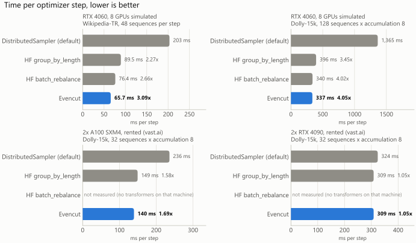
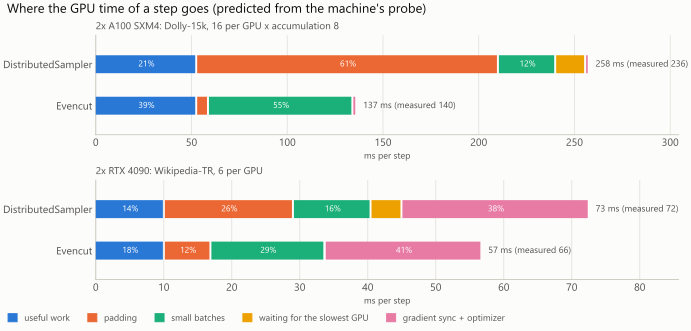
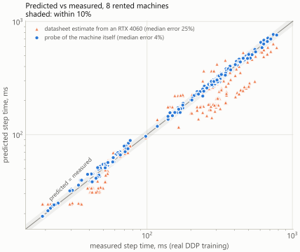
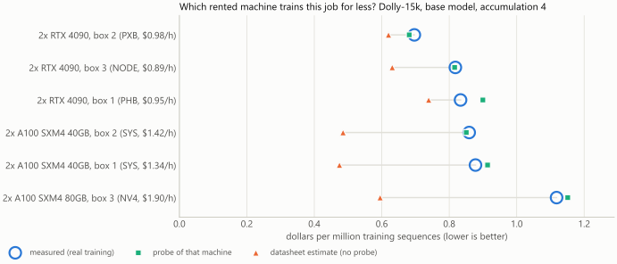
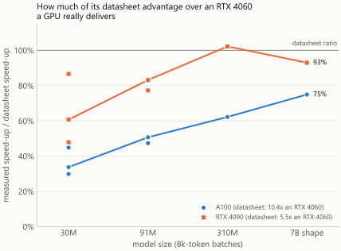
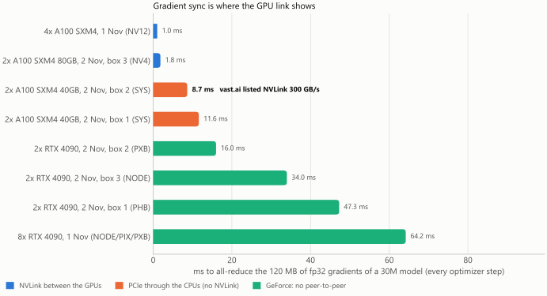
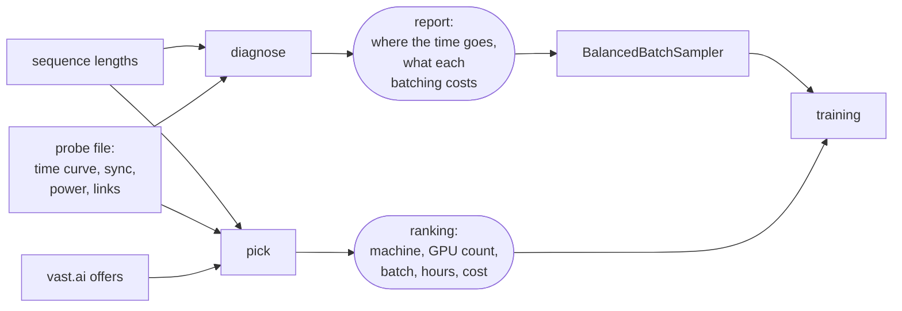

<p align="right"><b>English</b> · <a href="README.tr.md">Türkçe</a></p>

# Evencut

**Find the GPU time your data-parallel training loses to padding and waiting, win it back with a
drop-in batch sampler, and pick the machine that finishes the job for the least money.**

[](#license)
[](pyproject.toml)
[](https://github.com/AlemdarCode/evencut/actions/workflows/tests.yml)

In data-parallel training every GPU pads its batch to the longest sequence in it, and every
optimizer step waits for the slowest GPU. With text of mixed lengths that can be most of the GPU
time. Evencut measures how much, removes it without changing which sequences train together in a
step, and tells you which machine runs your job for the least money.

```bash
git clone https://github.com/AlemdarCode/evencut && cd evencut && pip install ".[train]"   # not on PyPI yet

# 1. Where does the GPU time go? No GPU needed; takes seconds.
evencut-train diagnose lengths.txt --gpus 8 --per-device-batch 8 --max-len 2048

# 2. Measure a machine for your model shape: about two minutes, run on that machine.
torchrun --standalone --nproc-per-node=gpu -m evencut.train probe \
    --layers 12 --d-model 768 --vocab 32000 --max-len 2048 --price-per-hour 1.90 -o box.json

# 3. Which machine finishes the job for the least money?
evencut-train pick lengths.txt --sequences-per-step 64 --per-device-batch 8 --probe box.json other.json
```

The fix is one line in the training script:

```python
loader = DataLoader(ds, batch_sampler=BalancedBatchSampler(lengths, per_device_batch=8), collate_fn=pad_to_longest)
```

## Contents

- [Results](#results)
- [Install](#install)
- [1. Diagnose](#1-diagnose-where-the-gpu-time-goes)
- [2. Fix](#2-fix-balancedbatchsampler)
- [3. Probe and pick](#3-probe-and-pick-the-cheapest-machine-for-the-job)
- [NVLink and gradient sync](#nvlink-and-gradient-sync)
- [Try it on your own data](#try-it-on-your-own-data)
- [When not to use it](#when-not-to-use-it)
- [Hardware support](#hardware-support)
- [How it works](#how-it-works)
- [How we tested](#how-we-tested)
- [The partitioning engine](#the-partitioning-engine)
- [Layout](#layout) · [Contributing](#contributing) · [License](#license) · [Acknowledgements](#acknowledgements)

## Results

<picture>
  <source media="(prefers-color-scheme: dark)" srcset="docs/figures/step-time-dark.svg">
  
</picture>

Time per optimizer step, lower is better. Speed-ups are against the default `DistributedSampler`.

| setup | DistributedSampler | HF `group_by_length` | HF `batch_rebalance` | Evencut |
|---|--:|--:|--:|--:|
| 2x A100 SXM4 80GB, rented. Dolly-15k, 32 sequences × accumulation 8 | 236.1 ms | 149.4 ms (1.58x) | not run | **139.5 ms (1.69x)** |
| 2x RTX 4090, rented. Same job | 323.9 ms | 308.5 ms (1.05x) | not run | **308.5 ms (1.05x)** |
| RTX 4060 simulating 8 GPUs. Dolly-15k, 128 sequences × accumulation 8 | 1,365 ms | 395.9 ms (3.45x) | 339.7 ms (4.02x) | **337.2 ms (4.05x)** |
| RTX 4060 simulating 8 GPUs. Wikipedia-TR, 48 sequences per step | 203.2 ms | 89.5 ms (2.27x) | 76.4 ms (2.66x) | **65.7 ms (3.09x)** |

Sources: [`vast_a100x2_v3/ddp_dolly_accum8.md`](bench/results/vast_a100x2_v3/ddp_dolly_accum8.md),
[`vast_rtx4090x2_v3/ddp_dolly_accum8.md`](bench/results/vast_rtx4090x2_v3/ddp_dolly_accum8.md),
[`gpu_batches_dolly_accum8.md`](bench/results/gpu_batches_dolly_accum8.md),
[`gpu_batches_wikipedia_v2.md`](bench/results/gpu_batches_wikipedia_v2.md).
"Simulating" means each GPU's batch was run in turn on one RTX 4060, and a step took as long as its
slowest batch. The rented runs are real multi-GPU DDP training, gradient sync included.
`batch_rebalance` was only run where transformers was installed.

- **Same sequences, faster steps.** In every Evencut row, each optimizer step trains on exactly
  the sequences a shuffled `DistributedSampler` run puts in it. Only which GPU gets which
  sequence changes. Hugging Face's `group_by_length` instead groups similar lengths into the same
  steps, which changes what trains together.
- **Not every machine gains.** On the 2x RTX 4090 box, Evencut cut padding from 73% to 10% of
  the tokens, yet the step got only 5% faster. This small model's batches ran near the GPUs'
  kernel-launch floor, so padded tokens cost little time. `diagnose` with a probe of the machine
  shows this before you change anything.
- **A two-minute probe predicts real step times.** Across 8 rented machines, the probe's
  prediction was within 3.6% of the measured step time (median over 272 measured configurations;
  93% within 10%). Scaling another GPU's probe by datasheet TFLOPS was 25% off (median).
- **Probes pick the right machine.** Ranking six rented machines by cost per job, the probes
  named the cheapest one in 7 of 8 cases; the miss was a 3% tie. Datasheet estimates named it in
  2 of 8.

Where every number comes from is listed in [How we tested](#how-we-tested).

## Install

Evencut is not on PyPI yet. Install it from a clone. The native library needs a C++20 compiler
and CMake.

```bash
git clone https://github.com/AlemdarCode/evencut && cd evencut
pip install ".[train]"     # evencut, the evencut-train command, and tokenizers for `evencut-train lengths`
pip install ".[hf]"        # adds the Hugging Face Trainer integration
```

Install PyTorch yourself, in the build that matches your GPU. The sampler and `probe` need it;
`diagnose` and `pick` do not.

Tested with Python 3.9 to 3.13 on Windows (MSVC) and Ubuntu 24.04 (GCC), with Python 3.13 on
macOS 26 on Apple Silicon (Apple clang), and on Linux in the containers of the GPU runs.
[GitHub Actions](https://github.com/AlemdarCode/evencut/actions/workflows/tests.yml) repeats all of
these on every push. Library versions: PyTorch 2.14 (GPU runs) and 2.15 (CPU), transformers 5.22,
Lightning 2.6, Accelerate 1.15.

## 1. Diagnose: where the GPU time goes

`diagnose` needs one number per training sequence: its token count. You can make that file with:

- `evencut-train lengths data.jsonl --fields text --tokenizer gpt2 -o lengths.txt` (needs `tokenizers`), or
- your own code, writing one length per line.

`diagnose` replays your batching on those lengths and splits the GPU time into parts. It runs on
the CPU in seconds.

Without a probe, cost is counted in padded tokens and every step is assumed to be compute-bound,
so the speed-ups are upper bounds; their ranking held up in our measurements. With `--probe` (a file from
[step 3](#3-probe-and-pick-the-cheapest-machine-for-the-job)), every batch is timed by the
machine's measured time curve. That curve includes how slowly a GPU runs a batch that is too
small to keep it busy.

Example: Turkish Wikipedia (534,988 articles, cut at 2,048 tokens), 2 GPUs × 6 sequences, timed
with a probe of a rented 2x A100:

```bash
evencut-train diagnose wikipedia_tr.txt --gpus 2 --per-device-batch 6 --max-len 2048 \
    --probe bench/results/vast_a100x2_v3/probe_small.json --price-per-hour 1.90
```

The report first splits the GPU time of the batching you have now (`DistributedSampler`): 21.9%
useful work, 41.1% padding, 14.6% small batches that do not fill the GPU, 17.4% waiting for the
slowest GPU and 5.0% fixed time (gradient sync and optimizer). Then it replays the alternatives on
the same sequences:

| strategy | keeps each step's sequences | speed | step ms | useful | padding | small batches | waiting |
|---|:-:|--:|--:|--:|--:|--:|--:|
| `DistributedSampler` (now) | yes | 1.00× | 37.6 | 21.9% | 41.1% | 14.6% | 17.4% |
| each global batch sorted by length, equal counts per GPU | yes | 1.00× | 37.6 | 21.9% | 24.4% | 23.5% | 25.2% |
| Hugging Face Trainer `group_by_length` | no | 1.71× | 21.9 | 37.5% | 1.4% | 50.9% | 1.1% |
| **Evencut `"step"`: same steps, each micro-step balanced** | **yes** | **1.66×** | **22.7** | 36.3% | 24.8% | 25.2% | 5.2% |
| Evencut `"pooled"`: length-grouped steps, balanced | no | 1.72× | 21.9 | 37.6% | 1.4% | 51.0% | 0.9% |
| Evencut `"sorted"`: max-token batches over the sorted data (fairseq-style) | no¹ | 1.98× | 18.9 | 43.4% | 0.1% | 45.5% | 0.3% |
| ceiling: no padding, perfect balance (packing) | – | 3.72× | 10.1 | 81.5% | 0.0% | 0.0% | 0.0% |

¹ The number of sequences per optimizer step varies. Hugging Face's `batch_rebalance` is compared
too when transformers 5.17 or newer is installed.

Its advice:

> Switch to: Evencut, same steps as now, each micro-step balanced. Predicted 1.66x faster steps
> (40% less GPU time); every step keeps the sequences it has now.

It adds that the faster rows change which sequences train together, and prints the line for your
DataLoader:

```python
DataLoader(dataset, batch_sampler=BalancedBatchSampler(lengths, per_device_batch=6, mode='step', max_len=2048), collate_fn=pad_to_longest)
```

<details>
<summary>The full terminal output</summary>

```text
$ evencut-train diagnose wikipedia_tr.txt --gpus 2 --per-device-batch 6 --max-len 2048 \
      --probe bench/results/vast_a100x2_v3/probe_small.json --price-per-hour 1.90
Evencut diagnosis
  data     534,988 sequences, 273,052,964 tokens; length mean 510, median 275, p90 1474, p99 2048, max 2048 (cut at 2048, 34,691 cut)
  setup    2 GPUs x 6 sequences = 12 per micro-step, accumulation 1; padded to each batch's longest; GPUs wait for each other once per optimizer step (DDP)
  cost     measured on 2x NVIDIA A100-SXM4-80GB (probe_small.json): time of one micro-batch by its size (forward + backward, slowest GPU)
  replay   400 optimizer steps, seed 0; length-grouped strategies sort 25 optimizer steps together

Where the GPU time goes now (DistributedSampler (random order, equal counts per GPU)):
  useful work                   21.9%  #####...................
  padding                       41.1%  ##########..............
  small batches (GPU not full)  14.6%  ####....................
  waiting for the slowest GPU   17.4%  ####....................
  fixed time (sync, optimizer)   5.0%  #.......................
  predicted from the probe: a run of 0.47 h on 2 GPUs = 0.93 GPU-h, of which 0.68 GPU-h go to padding, small batches and waiting ($0.65 at $0.95/GPU-h; up to 0.18 kWh at 262 W/GPU, measured under full load by the probe)

Alternatives, same sequences (step time vs now; shares of GPU time):
    strategy                                                              speed  step ms  useful  padding  small  waiting  peak batch
  ->DistributedSampler (random order, equal counts per GPU)               1.00x     37.6   21.9%    41.1%  14.6%    17.4%      12,288
    global batch sorted by length, equal counts per GPU                   1.00x     37.6   21.9%    24.4%  23.5%    25.2%      12,288
    Hugging Face Trainer group_by_length                                  1.71x     21.9   37.5%     1.4%  50.9%     1.1%      12,288
    Hugging Face Trainer batch_rebalance                                 (needs transformers>=5.17 with torch installed to compare)
    Evencut, same steps as now, each micro-step balanced                  1.66x     22.7   36.3%    24.8%  25.2%     5.2%      10,888
    Evencut, length-grouped steps (like group_by_length), balanced        1.72x     21.9   37.6%     1.4%  51.0%     0.9%      12,362
    whole sample sorted, max-token batches (fairseq-style = Evencut) *    1.98x     18.9   43.4%     0.1%  45.5%     0.3%       4,560
    ceiling: no padding, perfect balance (packing)                        3.72x     10.1   81.5%     0.0%   0.0%     0.0%           -
  * the number of sequences per optimizer step varies
  peak batch = largest padded batch (tokens) one GPU holds: a memory check
  best alternative saves 0.23 h of the run (0.46 GPU-h, $0.44, up to 0.12 kWh)

Advice: Switch to: Evencut, same steps as now, each micro-step balanced. Predicted 1.66x faster steps (40% less GPU time); every step keeps the sequences it has now. Grouping similar lengths into the same steps (Evencut, length-grouped steps (like group_by_length), balanced) is predicted at 1.72x, but it changes which sequences train together. The probe's measured times already include how slowly a GPU runs small batches; check that your model trains as well with grouped steps before switching. If your training can take a varying number of sequences per step, sorting the whole dataset into max-token batches is predicted at 1.98x. Even then 47% of the GPU time stays padding, small batches or waiting; only packing (no padding at all, full batches) recovers it.
  small = time lost because a batch is too small to keep the GPU busy (measured by the probe)
  note: replayed 400 of 44582 optimizer steps (4,800 sequences); raise sample_steps to replay more

How (PyTorch DataLoader; see evencut.train.hf for the Hugging Face Trainer):
  DataLoader(dataset, batch_sampler=BalancedBatchSampler(lengths, per_device_batch=6, mode='step', max_len=2048), collate_fn=pad_to_longest)
```

</details>

The report also gives hours, GPU-hours, dollars and kWh. It names the batching you use now
(`--current`) and covers FSDP or ZeRO-3, where GPUs synchronise every micro-step (`--fsdp`). See
`evencut-train diagnose --help` for all options.

<picture>
  <source media="(prefers-color-scheme: dark)" srcset="docs/figures/time-parts-dark.svg">
  
</picture>

What the probe predicts for one optimizer step, in milliseconds, next to the step time measured in
real training:

| machine, job | batching | useful | padding | small batches | waiting | sync + optimizer | predicted | measured |
|---|---|--:|--:|--:|--:|--:|--:|--:|
| 2x A100, Dolly-15k, 16 per GPU × 8 | DistributedSampler | 53.0 | 157.6 | 29.9 | 15.6 | 1.9 | 257.9 | 236.1 |
| | Evencut | 53.0 | 6.1 | 75.4 | 0.0 | 2.0 | 136.5 | 139.5 |
| 2x RTX 4090, Wikipedia-TR, 6 per GPU | DistributedSampler | 10.2 | 19.0 | 11.4 | 4.5 | 27.5 | 72.6 | 71.8 |
| | Evencut | 10.2 | 6.8 | 16.8 | 0.1 | 23.0 | 56.9 | 66.2 |

Source: `diagnose --probe` with the probe files in
[`bench/results/vast_a100x2_v3`](bench/results/vast_a100x2_v3) and
[`vast_rtx4090x2_v3`](bench/results/vast_rtx4090x2_v3). The figure's numbers are in
[`docs/figures/figures.json`](docs/figures/figures.json).

Balancing turns part of the padding into small batches. Each GPU's batches get smaller, and a GPU
runs a small batch below full speed. That is why the gain is smaller than the padding share. On
the 4090 box the prediction for Evencut was 14% optimistic; the box's gradient sync (34 ms over
PCIe) is a large, fixed part of its step.

## 2. Fix: BalancedBatchSampler

`BalancedBatchSampler` replaces `DistributedSampler`. Every rank builds the same plan from the
seed and the epoch, without communicating, and yields its own batches.

In the default `"window"` mode, every optimizer step holds exactly the sequences a shuffled
`DistributedSampler` would put in it. What changes is the split: which GPU gets which sequences,
and how many, so that the slowest GPU finishes as early as possible. The collate function must pad
each batch to its own longest sequence (dynamic padding); otherwise there is nothing to save.

> [!IMPORTANT]
> Per-GPU batches now differ in size. A loss averaged per GPU (`loss.mean()`) would give the
> sequences in small batches too much weight. Sum the token losses and multiply by
> `sampler.loss_scale(i)`. That trains on the token mean of the whole optimizer step, as one big
> batch would. The Hugging Face Trainer already does this for you.

**PyTorch DDP**

```python
from torch.utils.data import DataLoader
from evencut.train import BalancedBatchSampler

sampler = BalancedBatchSampler(lengths, per_device_batch=8, accum=4, max_len=2048)  # rank and world size from torchrun
loader = DataLoader(dataset, batch_sampler=sampler, collate_fn=pad_to_longest)

for epoch in range(epochs):
    sampler.set_epoch(epoch)
    for i, (tokens, labels) in enumerate(loader):
        logits = model(tokens)
        loss = F.cross_entropy(logits.flatten(0, 1), labels.flatten(), ignore_index=-100, reduction="sum")
        (loss * sampler.loss_scale(i)).backward()        # token mean over the whole optimizer step
        if (i + 1) % sampler.accum == 0:
            optimizer.step()
            optimizer.zero_grad()
```

`loss_scale` divides by every token of the step, as given in `lengths`. If fewer tokens carry a
label (shifted labels, masked prompts), divide by your own count of label tokens.
`evencut.train.global_count(n)` sums a number over all GPUs with one all-reduce.

**Hugging Face Trainer**

```python
from evencut.train.hf import EvencutTrainer

trainer = EvencutTrainer(model=model, args=args, train_dataset=ds, data_collator=collator)  # was: Trainer(...)
```

The per-device batch size, accumulation steps, seed and `dataloader_drop_last` come from
`TrainingArguments`. The collator must pad to the longest sequence in each batch, for example
`DataCollatorWithPadding`. Lengths come from the `length_column_name` column if the dataset has
one, otherwise from `input_ids`, or you pass `evencut_lengths=[...]`.

**PyTorch Lightning**

```python
trainer = L.Trainer(strategy="ddp", use_distributed_sampler=False, accumulate_grad_batches=4)

class Model(L.LightningModule):
    def train_dataloader(self):
        self.sampler = BalancedBatchSampler(lengths, per_device_batch=8, accum=4)
        return DataLoader(ds, batch_sampler=self.sampler, collate_fn=pad_to_longest)

    def training_step(self, batch, batch_idx):
        return token_loss_sum(batch) * self.sampler.loss_scale(batch_idx, accum_divided=True)
```

**Accelerate**

```python
from evencut.train import BalancedBatchSampler, accelerate_prepare

loader = accelerate_prepare(accelerator, DataLoader(ds, batch_sampler=sampler, collate_fn=pad_to_longest))
...
accelerator.backward(token_loss_sum * sampler.loss_scale(i, accum_divided=True))
```

Plain `accelerator.prepare` would split the batches over the GPUs a second time, so use
`accelerate_prepare`. `accum_divided=True` is needed because Lightning and Accelerate divide the
loss by the accumulation steps themselves.

Each of the four recipes has a test. The tests check that every rank trains exactly its planned
batches, that epochs reshuffle, and that the first optimizer step's gradient equals the whole
step's gradient computed in one process. The tests are
[`test_sampler_torch.py`](tests/python/test_sampler_torch.py),
[`test_hf_trainer.py`](tests/python/test_hf_trainer.py),
[`test_lightning.py`](tests/python/test_lightning.py) and
[`test_accelerate.py`](tests/python/test_accelerate.py); they run with two processes on the CPU.

| mode | what it changes | use it when |
|---|---|---|
| `"window"` (default) | which GPU gets which sequence of the optimizer step; with accumulation, balanced over the whole step | DDP; same steps as `DistributedSampler` |
| `"step"` | balances each micro-step on its own | FSDP and ZeRO-3, where GPUs wait for each other every micro-step; `"window"` with `sync_every_microstep=True` does the same |
| `"pooled"` | groups similar lengths into the same steps, like `group_by_length` | pads less, but changes which sequences train together; slower than `"window"` in our RTX 4060 runs |
| `"sorted"` | max-token batches over the sorted epoch (fairseq-style) | the number of sequences per step may vary |

`EvencutTrainer` turns on per-micro-step balancing by itself under FSDP and ZeRO-3. That path is
unit-tested but was not measured on hardware.

## 3. Probe and pick: the cheapest machine for the job

**Probe.** Run `evencut-train probe` on the machine, on all its GPUs, with your model's shape.
Every GPU at once times forward + backward of a synthetic decoder of that shape. It uses about 20
batch shapes, from one short sequence up to `--max-tokens` padded tokens.

The probe also measures:

- the gradient all-reduce at several sizes, and how much of it DDP leaves exposed;
- one AdamW step;
- bf16 matmul TFLOPS;
- board power under load;
- the GPU links (`nvidia-smi topo -m`) and peer-to-peer access.

For a model that does not fit one GPU, `--probe-layers k` builds only k layers and scales the
times by the FLOP ratio. We probed a 7B shape (6.6B weights) on an 8 GB RTX 4060 with
`--layers 32 --d-model 4096 --vocab 32000 --probe-layers 2`. A probe takes one to two minutes
and costs a few cents on a rented machine.

**Pick.** `pick` replays your job on every probed machine with its measured time curve. It uses
the GPU count, per-GPU batch and accumulation that keep your sequences per optimizer step. It then
ranks the machines by total cost (or by wall time with `--by time`).

Example: the Wikipedia job from above, on three rented machines that were probed:

```bash
evencut-train pick wikipedia_tr.txt --sequences-per-step 12 --per-device-batch 6 --max-len 2048 \
    --probe vast_a100x2_v3/probe_small.json vast_rtx4090x2_v3/probe_small.json vast_a100x2/probe_small.json \
    --price vast_a100x2_v3/probe_small.json=1.904 --price vast_rtx4090x2_v3/probe_small.json=0.891 \
    --price vast_a100x2/probe_small.json=1.341
```

The ranking it prints, for the whole job (534,988 sequences, one epoch, a 30M model):

| # | machine (probe folder) | $/h | batch | step ms | default | time | cost | kWh | notes |
|--:|---|--:|--:|--:|--:|--:|--:|--:|---|
| 1 | 2x A100-SXM4-80GB (`vast_a100x2_v3`) | 1.90 | 6×1 | 22.5 | 37.4 | 17&nbsp;min | **$0.53** | 0.1 | |
| 2 | 2x RTX 4090 (`vast_rtx4090x2_v3`) | 0.89 | 6×1 | 56.8 | 72.7 | 42&nbsp;min | $0.63 | 0.3 | no peer-to-peer, slowest GPU 20% behind |
| 3 | 2x A100-SXM4-40GB (`vast_a100x2`) | 1.34 | 6×1 | 44.6 | 53.3 | 33&nbsp;min | $0.74 | 0.3 | slowest GPU 16% behind |

`batch` is sequences per GPU per micro-step × accumulation. `step ms` is the step time with
Evencut's batching, `default` the step time with `DistributedSampler`. kWh uses the power the probe
measured, or the board's power limit (an upper bound) where it could not read it. The cheapest
machine per hour, the 2x RTX 4090, would cost $0.63: 1.2× the best pick.

<details>
<summary>The full terminal output</summary>

```text
$ evencut-train pick wikipedia_tr.txt --sequences-per-step 12 --per-device-batch 6 --max-len 2048 \
      --probe vast_a100x2_v3/probe_small.json vast_rtx4090x2_v3/probe_small.json vast_a100x2/probe_small.json \
      --price vast_a100x2_v3/probe_small.json=1.904 --price vast_rtx4090x2_v3/probe_small.json=0.891 \
      --price vast_a100x2/probe_small.json=1.341
Evencut pick
  job      534,988 sequences x 1 epoch(s), 12 sequences per optimizer step, at most 6 per GPU per micro-step; model 8 layers x 512 wide (30M weights)
  ranked   by total cost; Evencut batching (the default DistributedSampler split in the 'default' column)

   # machine                                                 $/h     batch  step ms  default      time      cost     kWh  notes
   1 2x A100-SXM4-80GB (vast_a100x2_v3/probe_small.json)    1.90       6x1     22.5     37.4    17 min     $0.53     0.1
   2 2x RTX 4090 (vast_rtx4090x2_v3/probe_small.json)       0.89       6x1     56.8     72.7    42 min     $0.63     0.3  no peer-to-peer, slowest GPU 20% behind
   3 2x A100-SXM4-40GB (vast_a100x2/probe_small.json)       1.34       6x1     44.6     53.3    33 min     $0.74     0.3  slowest GPU 16% behind

  batch = sequences per GPU per micro-step x accumulation; default = step ms with DistributedSampler
  kWh: measured power where the probe could read it, else the board's power limit (an upper bound)
  the cheapest per hour (2x RTX 4090 (vast_rtx4090x2_v3/probe_small.json)) would cost $0.63, 1.2x the best pick
```

</details>

The machine that is most expensive per hour is the cheapest for this job. The two A100 boxes carry
the same GPU, yet one runs the step twice as fast as the other: it has NVLink, while the other
sends gradients across CPU sockets and has one slower GPU.

**Offers you have not probed.** `--offers` takes the JSON of `vastai search offers --raw` and
estimates every offer from a probe:

- If you have a probe of the same GPU model, its measured curve is used.
- Otherwise a probe of another GPU is scaled by datasheet TFLOPS.

Rows the estimate cannot separate from the first are marked `~#1 (within the error)`. Rows with a
different architecture or vendor are marked `datasheet estimate unreliable`. The report then names
the offers worth probing for two minutes before you rent for the whole job.

<picture>
  <source media="(prefers-color-scheme: dark)" srcset="docs/figures/probe-accuracy-dark.svg">
  
</picture>

| prediction of a real DDP step time | median error | worst | within 10% |
|---|--:|--:|--:|
| probe of the machine itself | 3.6% | 16.6% | 93% of 272 |
| probe of an RTX 4060, scaled by datasheet TFLOPS | 24.6% | 49.4% | 21% of 272 |

Per machine, the probe's median error was 1.4–4.6%. The first two boxes, at 5.7% and 7.3%, were
probed with an older version that counted the gradient sync in full. Source:
[`backtest_probe.md`](bench/results/backtest_probe.md), sections D and E.

<picture>
  <source media="(prefers-color-scheme: dark)" srcset="docs/figures/machine-cost-dark.svg">
  
</picture>

Dollars per million training sequences, Dolly-15k, base model (91M), accumulation 4, Evencut
batching, at the prices paid:

| machine | measured | probe | datasheet estimate |
|---|--:|--:|--:|
| 2x RTX 4090, box 2 (PXB link, $0.98/h) | **$0.697** | **$0.681** | $0.620 |
| 2x RTX 4090, box 3 (NODE, $0.89/h) | $0.818 | $0.816 | $0.631 |
| 2x RTX 4090, box 1 (PHB, $0.95/h) | $0.834 | $0.900 | $0.739 |
| 2x A100 SXM4 40GB, box 2 (SYS, $1.42/h) | $0.859 | $0.851 | $0.485 |
| 2x A100 SXM4 40GB, box 1 (SYS, $1.34/h) | $0.878 | $0.914 | **$0.475** |
| 2x A100 SXM4 80GB, box 3 (NV4, $1.90/h) | $1.118 | $1.151 | $0.595 |

The datasheet would have sent this job to A100 box 1, which costs 26% more than the real
cheapest. Over all 12 jobs × batchings, probes named the cheapest machine in 11 cases and
datasheet estimates in 6 ([`backtest_probe.md`](bench/results/backtest_probe.md), section E).

<picture>
  <source media="(prefers-color-scheme: dark)" srcset="docs/figures/datasheet-by-size-dark.svg">
  
</picture>

Speed-up over an RTX 4060 on the same micro-batch (8k tokens, forward + backward), measured,
against the bf16 datasheet ratio:

| model | A100 SXM4 (datasheet 10.4x) | RTX 4090 (datasheet 5.5x) |
|---|---|---|
| small, 30M | 3.5x, 3.1x, 4.7x (three boxes) | 4.8x, 2.6x, 3.3x (three boxes) |
| base, 91M | 4.9x, 5.3x, 5.3x | 4.6x, 4.6x, 4.2x |
| large, 310M | 6.5x | 5.6x |
| 7B shape (2 of 32 layers timed) | 7.8x | 5.1x |

Datasheet ratios hold better within one architecture family: the RTX 4090 and the RTX 4060 are
both Ada. Across families they hold worse. Even for the 7B shape, the A100 reached only 75% of its
datasheet ratio. Boxes with the same GPU also differ: at 2k tokens the three 4090 boxes ran the
small model at 2.4x, 0.8x and 1.0x the 4060's speed, because small batches are bound by the
host's kernel-launch speed. Source: [`backtest_probe.md`](bench/results/backtest_probe.md),
section F.

## NVLink and gradient sync

At the end of every optimizer step, DDP all-reduces all gradients: 4 bytes per weight in fp32,
120 MB for our 30M model. How long that takes depends on the link between the GPUs, not on the
GPUs themselves.

<picture>
  <source media="(prefers-color-scheme: dark)" srcset="docs/figures/gradient-sync-dark.svg">
  
</picture>

| machine, rented on vast.ai | link (`nvidia-smi topo -m`) | vast's `bw_nvlink` | all-reduce, 120 MB |
|---|---|--:|--:|
| 4x A100 SXM4 80GB (1 Nov) | NV12 | 300 | 1.0 ms |
| 2x A100 SXM4 80GB, box 3 | NV4 | 300 | 1.8 ms |
| 2x A100 SXM4 40GB, box 2 | **SYS** | **300** | 8.7 ms |
| 2x A100 SXM4 40GB, box 1 | SYS | 0 | 11.6 ms |
| 2x RTX 4090, box 2 | PXB | 0 | 16.0 ms |
| 2x RTX 4090, box 3 | NODE | 0 | 34.0 ms |
| 2x RTX 4090, box 1 | PHB | 0 | 47.3 ms |
| 8x RTX 4090 (1 Nov) | NODE / PIX / PXB | 0 | 64.2 ms |

What the link names in `nvidia-smi`'s legend mean:

- **NV#** is NVLink, with # links bonded.
- **PIX** and **PXB** go through PCIe switches.
- **PHB** goes through a CPU's PCIe host bridge.
- **NODE** goes between host bridges of one CPU socket.
- **SYS** goes across CPU sockets.

GeForce cards also have no peer-to-peer access on these boxes.

Sources: the probe files in `bench/results/vast_*`, and
[`ddp_a100x4.md`](bench/results/ddp_a100x4.md) and [`ddp_batches.md`](bench/results/ddp_batches.md)
for the two machines rented on 1 Nov.

A fast link matters to Evencut. Where the sync is short, waiting for the slowest GPU is a larger
share of the step, so balancing gains more. On the same Dolly-15k job, Evencut gained 1.69x on the
NVLink A100 pair and 1.05x on the PCIe RTX 4090 pair. On the 4090 pair a 34 ms sync and the
kernel-launch floor left little to win.

> [!WARNING]
> **vast.ai's `bw_nvlink` field is not reliable when you rent part of a machine.** We rented three
> "A100 SXM4" pairs. Two of them had no NVLink between the two GPUs we got:
> `nvidia-smi topo -m` showed SYS, so traffic crossed CPU sockets. One of those two was listed
> with `bw_nvlink` 300 GB/s. The listing may describe the whole machine rather than the GPUs you
> get; from inside the container we could not tell why. For every probed machine `pick` uses the
> measured all-reduce. For an offer nobody has probed, it can only trust the listing.
>
> Our NVLink numbers also come from 2 and 4 GPUs rented out of larger machines. We never
> measured a complete 8-GPU NVSwitch machine, or H100/H200 NVLink. A real full NVLink box may
> sync faster than anything above, and then balancing would be worth more than our results show.
> **Probe a box before a long run.** It takes two minutes, and the probe file records the links,
> peer-to-peer access and the measured all-reduce.

## Try it on your own data

1. **Get the lengths.** Run `evencut-train lengths train.jsonl --fields text --tokenizer <your
   tokenizer> -o lengths.txt`. With a tokenized Hugging Face dataset you can also write
   `len(x)` of every `input_ids` row, one per line.
2. **Diagnose.** Run `evencut-train diagnose lengths.txt --gpus 8 --per-device-batch 8 --accum 4
   --max-len 4096`. No GPU is needed. If you know today's step time, add `--step-ms 850
   --price-per-hour 14.2` to get hours and dollars.
3. **Switch the sampler** if the diagnosis predicts a real gain. Train a few hundred steps and
   compare the step time with what you had.
4. **Before renting for a long run,** probe two or three candidates (about two minutes each) and
   run `pick`.

No data at hand? A synthetic long tail shows what the report looks like:

```bash
python -c "import random; random.seed(0); print('\n'.join(str(min(4096, int(random.lognormvariate(6, 1)))) for _ in range(100000)))" > lengths.txt
evencut-train diagnose lengths.txt --gpus 8 --per-device-batch 8 --max-len 4096
```

## When not to use it

- **You already pack sequences** (concatenated to a fixed length, no padding). Then there is
  nothing to save; the diagnosis shows packing as the ceiling.
- **The diagnosis predicts only a few percent.** Changing the sampler is not worth it below about 3%.
- **A small model on a fast GPU.** When batches run at the kernel-launch floor, padding costs
  almost nothing, as in the 2x RTX 4090 Dolly-15k run (1.05x). `diagnose --probe` accounts for this.
- **Gradient sync dominates the step,** as with GeForce cards over PCIe or SYS links. Change the
  link or the machine first; `pick` shows which.
- **You need the cost of a machine you cannot rent briefly.** Without a probe, `pick`'s estimate
  is rough (25% median error, often wrong about the cheapest machine).
- **Sequence, tensor or pipeline parallelism.** The sampler balances data-parallel ranks only. The
  engine's pipeline-stage and context-chunk helpers ([below](#the-partitioning-engine)) were
  modelled, not measured on GPUs.

## Hardware support

| hardware | status |
|---|---|
| NVIDIA GPUs (CUDA; bf16 needs compute capability 8.0+) | **tested**: RTX 4060, RTX 4090, A100 SXM4 40 GB and 80 GB |
| AMD GPUs (ROCm build of PyTorch) | **prepared, not tested**: ROCm exposes the same `torch.cuda` interface and RCCL behind the `"nccl"` backend; power is read with `amd-smi` or `rocm-smi`; links are not read |
| Intel XPU, Apple MPS, Google TPU | **not supported** by `probe`: it would time the CPU |

The sampler, `diagnose` and `pick` do not depend on the hardware. `pick` knows bf16 datasheet
figures for NVIDIA cards from Ampere on and for AMD MI210, MI250, MI250X and MI300X. Offers for
older cards are skipped and listed as skipped.

## How it works



- **One plan, no communication.** Every rank shuffles with the same seed and epoch, so all ranks
  see the same optimizer steps. Each step's sequences, across GPUs × micro-steps, are cut so that
  the slowest GPU's total cost is as small as possible. The cuts come from the exact partitioning
  engine below, and each rank then takes its own share.
- **Cost of a batch.** By default this is padded tokens (sequences × longest). With a probe it is
  the measured time curve: milliseconds per micro-batch against its padded size, including the
  floor that small batches cannot go below. For long sequences, `AttentionCost` adds attention's
  quadratic term.
- **Gradient sync.** DDP overlaps the all-reduce with the last micro-batch's backward pass. The
  probe times pairs of steps, one with `no_sync` and one synced, to measure how much stays exposed.
  On two 4090 boxes this cut the error on the TinyStories and Wikipedia runs from 17–21% to 0–3%.
- **Pick** replays your job on each candidate with its curve, GPU count, per-GPU batch and
  accumulation. Cost is hours × price per hour; energy uses the measured power.

## How we tested

**Machines.**

- One local RTX 4060, simulating 8 GPUs as described under [Results](#results).
- Machines rented on vast.ai on 1–2 November 2026:
  - 4x A100 SXM4 80GB
  - 8x RTX 4090
  - three 2x A100 SXM4 boxes (40, 40 and 80 GB)
  - four 2x RTX 4090 boxes, one of them for the large model
  - 1x A100 SXM4 40GB

The rented machines cost about **$3.13 in total**. Every instance was destroyed after its run.

**Models.** All are decoders of the same shape family, trained in bf16:

| model | parameters | shape |
|---|--:|---|
| small | 29.9M | 8 layers × 512 |
| base | 91.2M | 12 layers × 768 |
| large | 310M | 24 layers × 1024 |
| 7B shape | 6.6B | 32 layers × 4096, vocabulary 32,000; probed with 2 layers built and scaled up |

**Datasets.** Only token lengths were used; no text is stored in this repository.

| dataset | sequences | license |
|---|--:|---|
| Turkish Wikipedia, [`wikimedia/wikipedia`](https://huggingface.co/datasets/wikimedia/wikipedia) `20231101.tr` | 534,988 | CC BY-SA 3.0 and GFDL |
| [databricks-dolly-15k](https://huggingface.co/datasets/databricks/databricks-dolly-15k) (GPT-2 tokenizer) | 15,011 | CC BY-SA 3.0 |
| [TinyStories-Turkish](https://huggingface.co/datasets/esat-krky/TinyStories_Turkish) | 359,954 | CDLA-Sharing-1.0 |

**What each result file shows.**

| file | shows |
|---|---|
| [`gpu_batches_*.md`](bench/results) | RTX 4060, 8 GPUs simulated, every batching strategy |
| [`ddp_*.md`](bench/results), [`vast_*/ddp_*.md`](bench/results) | real DDP runs on rented machines |
| [`backtest_probe.md`](bench/results/backtest_probe.md) | probe predictions against every real run (sections A–F) |
| [`backtest_diagnose.md`](bench/results/backtest_diagnose.md) | the diagnosis without a probe against the same runs |
| [`docs/figures/figures.json`](docs/figures/figures.json) | the numbers behind every figure; [`bench/make_figures.py`](bench/make_figures.py) redraws them |

**What did not go as well, or was not tested.**

- The probe's worst single prediction was 16.6% off. On the 2x RTX 4090 Wikipedia job,
  `diagnose` predicted Evencut's step 14% too fast.
- On one 4090 box, one TinyStories run measured 45.7 ms per step, below the 51.4 ms the probe
  measured as that machine's minimum. We have no explanation.
- The first two boxes were probed before the probe measured how DDP hides the sync. Their median
  errors were 5.7% and 7.3%, against 1.4–4.6% for the later boxes.
- Datasheet estimates were 25% off at the median, and up to 49%.
- Not tested: multi-node training, FSDP or ZeRO-3 on real hardware, H100 or H200, a complete
  8-GPU NVLink machine, and AMD GPUs.

**Test suites.**

- Python: 135 tests pass on the native backend and 134 on the pure-Python backend. The skipped
  ones need PyTorch or transformers (and, on the pure backend, one needs the native library).
  With PyTorch, transformers, Lightning, Accelerate and the HTTP service installed, all 162 run
  and pass.
- During development, 60 deliberately injected bugs in the training layers were all caught by
  these tests. The mutation scripts are not part of the repository.
- The engine's tests are described [below](#the-partitioning-engine).

```bash
pip install ".[test,service]" && pytest
EVENCUT_FORCE_PURE=1 pytest
```

## The partitioning engine

Under the training tools is an exact partitioning engine. Give it an ordered list of costs and a
number of parts *k*; it returns the cut points that make the parts as even as possible. The
answer is a proven optimum, not a heuristic, and ten million items take 48 ms (`min_max`, C++).

| objective | what "even" means | typical use |
|---|---|---|
| `min_max` | the largest part is as small as possible | pipeline stages, makespan, the slowest worker |
| `sum_squares` | the sum of squared part loads is as small as possible | overall evenness, sharding |
| tree `min_max` | k connected parts of a tree, largest part as small as possible | hierarchies, directory trees |

It supports constraints: cut positions that are not allowed, and a second resource with a limit
per part (for example memory per pipeline stage). It ships as a header-only C++20 library, a C ABI
shared library, a command-line tool, a Python package, an HTTP/JSON service and a Docker image.

<details>
<summary><b>Python, CLI, HTTP, Docker, C++ and C usage</b></summary>

```python
import evencut

w = [5, 3, 8, 2, 7, 4, 6, 1, 9, 5]
mem = [4, 4, 6, 6, 6, 6, 6, 6, 8, 8]

r = evencut.partition(w, 3)
r.ends        # (4, 7, 10): parts [0,4) [4,7) [7,10)
r.loads       # (18, 17, 15)
r.max_load    # 18, and no split into 3 parts does better

evencut.partition(w, 3, objective="sum_squares")
evencut.partition(w, 3, forbidden_cuts=[4])                       # never cut at position 4
evencut.partition(w, 3, secondary=mem, secondary_limit=24)        # every part: sum(mem) <= 24
evencut.evaluate(w, [4, 7, 10])                                   # measure an existing split
evencut.partition_tree([None, 0, 0, 1], [4, 3, 5, 2], 2)          # connected parts of a tree
evencut.quantize([0.25, 1.5], scale=1000)                         # real numbers -> [250, 1500]
```

The AI helpers in `evencut.ai` work on modelled costs:

```python
from evencut import ai

plan = ai.pipeline_stages(layer_ms, num_stages=4, embedding_cost=emb_ms, head_cost=head_ms,
                          layer_memory=layer_gb, memory_limit=78.0)
plan.layers_per_stage()          # e.g. [8, 9, 9, 6]
plan.torchtitan_split_points()   # ["layers.8", "layers.17", "layers.26"]
plan.megatron_layout()           # "Etttttttt|ttttttttt|ttttttttt|ttttttL"
plan.deepspeed_parts()           # [0, 8, 17, 26, 32]  (PipelineModule.parts format)

ai.balanced_shards(sample_tokens, num_ranks=8)
ai.token_budget_batches(sample_tokens, max_tokens=8192)
ai.causal_attention_chunks(131072, num_ranks=8)
```

Megatron-Core's `--pipeline-model-parallel-layout` syntax may differ between versions; check it
against yours. DeepSpeed has no public option for explicit stage boundaries. `deepspeed_parts()`
matches the internal `PipelineModule.parts` list, so using it means overriding an internal method.

If the shared library is missing, a pure-Python implementation with identical results takes over.
`evencut.backend` says which one is active, and `EVENCUT_FORCE_PURE=1` forces Python.

**Command line**

```bash
echo "5 3 8 2 7 4 6 1 9 5" | evencut -k 3
{"objective":"min-max","parts":3,"ends":[4,7,10],"loads":[18,17,15],"max_load":18,"total":50,"sum_of_squares":"838","imbalance":1.08}

evencut -k 4 -o sum-squares weights.txt
evencut -k 4 --secondary memory.txt --secondary-limit 24 weights.txt
evencut -k 2 --parents parents.txt weights.txt      # tree mode
evencut --evaluate 4,7,10 weights.txt
```

Input may be separated by whitespace, commas or newlines, or be a JSON array; `#` starts a
comment. Exit codes: 0 success, 1 invalid input, 2 usage error, 3 internal error. Build the CLI
with CMake (`cmake -S . -B build && cmake --build build`), or with one compiler call, since the
engine is header-only: `g++ -std=c++20 -O2 -Iinclude cli/evencut_cli.cpp -o evencut`.

**HTTP service**

```bash
pip install ".[service]"
uvicorn evencut.service:app --host 127.0.0.1 --port 8000
curl -s -X POST http://127.0.0.1:8000/v1/partition -H "Content-Type: application/json" \
     -d '{"weights":[5,3,8,2,7,4,6,1,9,5],"k":3}'
```

- **Endpoints:** `GET /healthz`, `POST /v1/partition`, `/v1/evaluate`, `/v1/tree-partition`,
  `/v1/ai/pipeline-stages` and `/v1/ai/token-budget-batches`. Interactive docs are at `/docs`,
  and the OpenAPI 3.1 description is in [`openapi.json`](openapi.json).
- **Client examples** for Python, JavaScript and Go are in
  [`examples/clients/`](examples/clients). The Go one has not been run.
- **Limits:** `EVENCUT_MAX_ITEMS` (default 2,000,000 per list) and `EVENCUT_MAX_BODY_BYTES`
  (64 MiB). Requests must send `Content-Length`.
- **No authentication.** Bind the service to localhost, or put it behind your own gateway.
- `sum_of_squares` is returned as a string, because JavaScript loses precision on numbers
  above 2^53.

**Docker**

```bash
docker build -f docker/Dockerfile -t evencut .
docker run --rm -p 127.0.0.1:8000:8000 evencut
echo "5 3 8 2 7 4 6 1 9 5" | docker run --rm -i evencut evencut -k 3
docker compose -f docker/compose.yaml up --build    # read-only, no capabilities, localhost only
```

**C++** (header-only, C++20, no dependencies; with CMake, `find_package(evencut)` and link
`evencut::headers`)

```cpp
#include <evencut/evencut.hpp>

std::vector<std::uint64_t> w{5, 3, 8, 2, 7, 4, 6, 1, 9, 5};
evencut::partition_result r = evencut::partition(w, 3);   // r.ends, r.loads, r.max_load ...

evencut::options opt;
opt.goal = evencut::objective::sum_squares;
std::vector<std::size_t> keep{4};
opt.forbidden_cuts = keep;
auto r2 = evencut::partition(w, 3, opt);                   // invalid input throws evencut::error
```

**C**, or any language with a C FFI (link `evencut::evencut`). No exception crosses the C
boundary; every call returns an `evencut_status`.

```c
#include <evencut/evencut.h>

evencut_options opt;
evencut_options_init(&opt);
size_t ends[3];
evencut_summary s;
if (evencut_partition(weights, n, 3, &opt, ends, 3, &s) != EVENCUT_OK)
    fprintf(stderr, "%s\n", evencut_last_error());
```

</details>

<details>
<summary><b>Concepts, guarantees and how the engine works</b></summary>

**Concepts**

- **Numbering.** `ends` are exclusive end indices: `(4, 7, 10)` means items `[0,4) [4,7) [7,10)`.
  `forbidden_cuts` uses the same numbers, so a forbidden position never appears in `ends`.
- **Integers.** Weights are non-negative integers below 2^64, and their total must fit too. For
  real numbers use `quantize(values, scale)`; for example `scale=1e6` turns seconds into
  microseconds.
- **More parts than items.** If `k` is larger than the number of items (or of allowed blocks),
  every block becomes its own part; `parts` tells how many there are.
- **Secondary limit.** A second value per item, with a cap per part (`min_max` only). The values
  and the limit must be given together; a limit is never silently skipped.
- **Determinism.** The same input always gives the same split. There is no global state, so the
  engine is thread-safe.

**Guarantees**

- Results are exact optima for any input whose total fits in 64 bits. Totals up to 2^40 use a
  128-bit fast path; larger totals use 256-bit arithmetic.
- Memory use is linear in the number of items.

Speed on an AMD Ryzen 5 5600 (median of 5 runs, 3 for ten million items;
[`speed.md`](bench/results/speed.md)):

| items | C++ `min_max` k=64 | k=4096 | C++ `sum_squares` k=64 | k=4096 | from Python, `min_max` k=64 |
|--:|--:|--:|--:|--:|--:|
| 403,394 (amazon0601) | 2 ms | 10 ms | 62 ms | 97 ms | 15 ms |
| 1,965,206 (roadNet-CA) | 9 ms | 24 ms | 310 ms | 509 ms | 76 ms |
| 10,000,000 (uniform) | 48 ms | 72 ms | 1.3 s | 2.5 s | 567 ms |

**How it works**

- **min_max.** A binary search on the bound. For a given bound, the greedy split needs the fewest
  parts, and this stays true with a per-part secondary limit. An optional polish pass then moves
  the other cuts towards the middle without raising the maximum.
- **sum_squares.** A Lagrangian relaxation ("Aliens trick") with *odd* penalties. Odd penalties
  make the optimal number of parts unique for every penalty, which keeps the search exact
  whatever the tie-breaking.
  - Each penalty is solved with the convex hull trick.
  - A safeguarded chord search finds the right penalty in a handful of passes.
  - When k lies on a straight piece of the cost curve, two neighbouring optima are spliced into an
    exact k-part optimum (quadrangle inequality).
- **Trees.** The Kundu-Misra greedy (fewest cuts for a bound) inside a binary search. It is
  iterative, so deep trees cannot overflow the stack.

**Tests** ([`test_suites.md`](bench/results/test_suites.md),
[`correctness_real.md`](bench/results/correctness_real.md))

- **Random inputs.** Every optimum is compared with brute force and with an independent dynamic
  program. The inputs include zeros, equal weights, totals near 2^64, forbidden cuts, secondary
  limits and trees.
  - The long runs made 28,932,456 checks with 0 failures. They ran on GCC (128-bit path and
    `-DEVENCUT_NO_INT128`), MSVC and UndefinedBehaviorSanitizer.
  - The default run of 2,000 rounds makes 130,467 checks on the 128-bit path and 73,565 without
    it.
- **Real data.** On 10 real datasets (NIST Matrix Market and the Stanford SNAP collection, up to
  6 million items, k = 2…4096), every `min_max` and `sum_squares` result was proven optimal. The
  `sum_squares` proofs come from a lower bound computed by a separate C program that shares no
  code with Evencut.
- **Compilers.** The C ABI is tested from plain C. The engine is built with MSVC `/W4 /WX` and
  AddressSanitizer.

```bash
cmake -S . -B build -G Ninja -DCMAKE_BUILD_TYPE=Release && cmake --build build && ctest --test-dir build
```

</details>

## Layout

```text
python/evencut/train/   diagnose, BalancedBatchSampler, EvencutTrainer, probe, pick, evencut-train CLI
python/evencut/         engine Python API, pure-Python fallback, AI helpers, HTTP service
include/evencut/        engine: evencut.hpp (C++, header-only), evencut.h (C ABI)
src/, cli/              C ABI shared library, command-line tool
tests/                  C++, C and Python tests
bench/                  benchmarks, GPU runs, backtests, figure script
bench/results/          every measurement quoted in this README
docs/figures/           the figures (light and dark SVG; Turkish copies in tr/) and their numbers
examples/clients/       HTTP clients (Python, JavaScript, Go)
docker/                 Dockerfile and compose file
.github/workflows/      the test suites, run by GitHub Actions on every push and pull request
openapi.json            HTTP API description
```

## Contributing

Issues and pull requests are welcome. Please include a test with any change, and run the three
Python suites (native, `EVENCUT_FORCE_PURE=1`, and with PyTorch) plus `ctest` for engine changes.
Code style is checked with ruff:
`uvx ruff check --select F,E9,B --line-length 120 bench python/evencut/train tests/python`.
GitHub Actions runs all of these on Linux, Windows and macOS for every pull request
([`tests.yml`](.github/workflows/tests.yml)).

Please report security problems privately, as described in [`SECURITY.md`](SECURITY.md), not in a
public issue.

Unless you explicitly state otherwise, any contribution intentionally submitted for inclusion in
the work by you, as defined in the Apache-2.0 license, shall be dual licensed as below, without any
additional terms or conditions.

## License

Licensed under either of

- Apache License, Version 2.0 ([LICENSE-APACHE](LICENSE-APACHE)), or
- MIT license ([LICENSE-MIT](LICENSE-MIT))

at your option. Copyright (c) 2026 AlemdarCode.

## Acknowledgements

- **Datasets.** Token lengths were derived from:
  - Turkish Wikipedia (Wikimedia Foundation, via `wikimedia/wikipedia`), CC BY-SA 3.0 and GFDL;
  - databricks-dolly-15k (Databricks), CC BY-SA 3.0;
  - TinyStories-Turkish (esat-krky), CDLA-Sharing-1.0.

  No text from these datasets is redistributed here.
- **Engine test data.** The engine was tested on matrices from the
  [NIST Matrix Market](https://math.nist.gov/MatrixMarket/) and networks from the
  [Stanford Large Network Dataset Collection](https://snap.stanford.edu/data/).
- **Hardware.** The GPU runs used machines rented on [vast.ai](https://vast.ai). vast.ai is not
  affiliated with this project.
