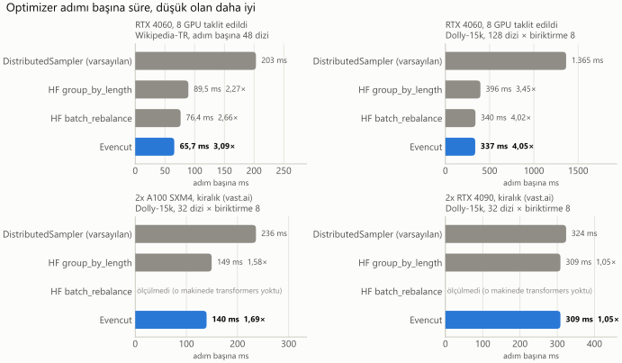
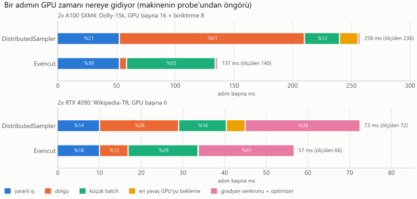
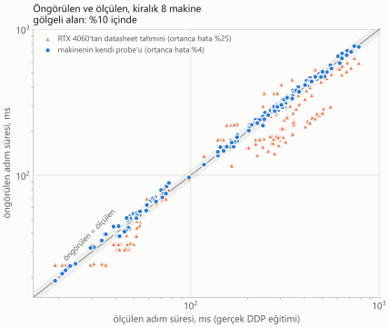
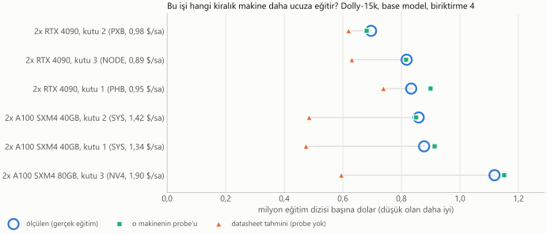
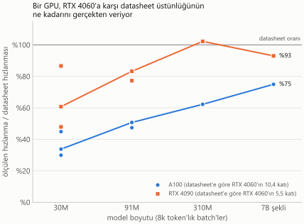
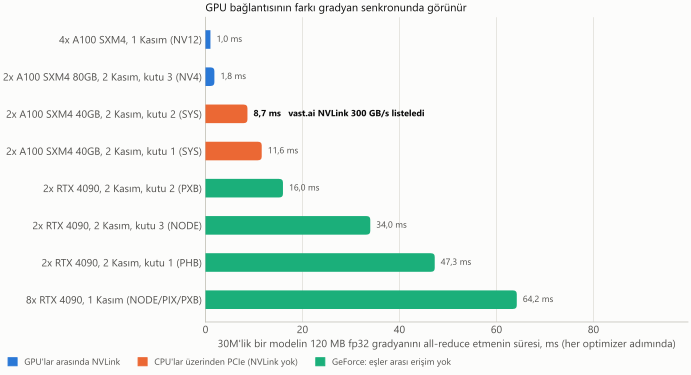
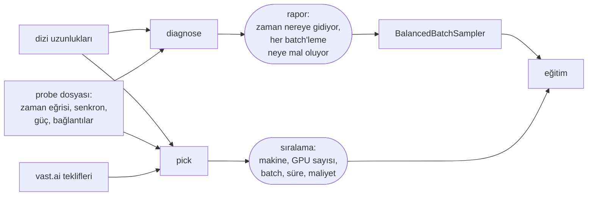

<p align="right"><a href="README.md">English</a> · <b>Türkçe</b></p>

# Evencut

**Veri paralel eğitimin dolguya (padding) ve beklemeye harcadığı GPU zamanını bul, bunu tak-çalıştır
bir batch sampler ile geri kazan ve işi en az parayla bitirecek makineyi seç.**

[](#lisans)
[](pyproject.toml)

Veri paralel eğitimde her GPU kendi batch'ini içindeki en uzun diziye kadar doldurur, her optimizer
adımı da en yavaş GPU'yu bekler. Uzunlukları karışık metinde bu, GPU zamanının çoğunu
götürebilir. Evencut bunun ne kadar olduğunu ölçer, bir adımda birlikte eğitilen dizileri
değiştirmeden bu kaybı giderir ve işini en az parayla çalıştıracak makineyi söyler.

```bash
git clone https://github.com/AlemdarCode/evencut && cd evencut && pip install ".[train]"   # henüz PyPI'de yok

# 1. GPU zamanı nereye gidiyor? GPU gerekmez; birkaç saniye sürer.
evencut-train diagnose lengths.txt --gpus 8 --per-device-batch 8 --max-len 2048

# 2. Bir makineyi model şeklin için ölç: yaklaşık iki dakika, o makinede çalıştırılır.
torchrun --standalone --nproc-per-node=gpu -m evencut.train probe \
    --layers 12 --d-model 768 --vocab 32000 --max-len 2048 --price-per-hour 1.90 -o box.json

# 3. İşi en az parayla hangi makine bitirir?
evencut-train pick lengths.txt --sequences-per-step 64 --per-device-batch 8 --probe box.json other.json
```

Düzeltme, eğitim betiğinde tek satırdır:

```python
loader = DataLoader(ds, batch_sampler=BalancedBatchSampler(lengths, per_device_batch=8), collate_fn=pad_to_longest)
```

## İçindekiler

- [Sonuçlar](#sonuçlar)
- [Kurulum](#kurulum)
- [1. Teşhis](#1-teşhis-gpu-zamanı-nereye-gidiyor)
- [2. Düzeltme](#2-düzeltme-balancedbatchsampler)
- [3. Probe ve pick](#3-probe-ve-pick-işi-en-ucuza-bitiren-makine)
- [NVLink ve gradyan senkronu](#nvlink-ve-gradyan-senkronu)
- [Kendi verinde dene](#kendi-verinde-dene)
- [Ne zaman kullanılmamalı](#ne-zaman-kullanılmamalı)
- [Donanım desteği](#donanım-desteği)
- [Nasıl çalışır](#nasıl-çalışır)
- [Nasıl test ettik](#nasıl-test-ettik)
- [Bölme motoru](#bölme-motoru)
- [Dosya düzeni](#dosya-düzeni) · [Katkı](#katkı) · [Lisans](#lisans) · [Teşekkür](#teşekkür)

## Sonuçlar

<picture>
  <source media="(prefers-color-scheme: dark)" srcset="docs/figures/tr/step-time-dark.svg">
  
</picture>

Optimizer adımı başına süre; düşük olan daha iyi. Hızlanmalar varsayılan `DistributedSampler`'a
göredir.

| düzen | DistributedSampler | HF `group_by_length` | HF `batch_rebalance` | Evencut |
|---|--:|--:|--:|--:|
| 2x A100 SXM4 80GB, kiralık. Dolly-15k, 32 dizi × biriktirme 8 | 236,1 ms | 149,4 ms (1,58×) | çalıştırılmadı | **139,5 ms (1,69×)** |
| 2x RTX 4090, kiralık. Aynı iş | 323,9 ms | 308,5 ms (1,05×) | çalıştırılmadı | **308,5 ms (1,05×)** |
| 8 GPU'yu taklit eden RTX 4060. Dolly-15k, 128 dizi × biriktirme 8 | 1.365 ms | 395,9 ms (3,45×) | 339,7 ms (4,02×) | **337,2 ms (4,05×)** |
| 8 GPU'yu taklit eden RTX 4060. Wikipedia-TR, adım başına 48 dizi | 203,2 ms | 89,5 ms (2,27×) | 76,4 ms (2,66×) | **65,7 ms (3,09×)** |

Kaynaklar: [`vast_a100x2_v3/ddp_dolly_accum8.md`](bench/results/vast_a100x2_v3/ddp_dolly_accum8.md),
[`vast_rtx4090x2_v3/ddp_dolly_accum8.md`](bench/results/vast_rtx4090x2_v3/ddp_dolly_accum8.md),
[`gpu_batches_dolly_accum8.md`](bench/results/gpu_batches_dolly_accum8.md),
[`gpu_batches_wikipedia_v2.md`](bench/results/gpu_batches_wikipedia_v2.md).
"Taklit" şu demek: her GPU'nun batch'i tek bir RTX 4060'ta sırayla çalıştırıldı ve bir adım, en
yavaş batch'i kadar sürdü. Kiralık makinelerdeki koşular ise gradyan senkronu dahil gerçek çok
GPU'lu DDP eğitimidir. `batch_rebalance` yalnızca transformers kurulu olan yerde çalıştırıldı.

- **Aynı diziler, daha hızlı adımlar.** Bütün Evencut satırlarında her optimizer adımı, karıştırılmış
  bir `DistributedSampler` koşusunun o adıma koyacağı dizilerin tam olarak aynısıyla eğitilir.
  Değişen tek şey hangi dizinin hangi GPU'ya gittiğidir. Hugging Face'in `group_by_length`'i ise
  benzer uzunlukları aynı adımlarda topladığı için birlikte eğitilen dizileri değiştirir.
- **Her makine kazanmıyor.** 2x RTX 4090 kutusunda Evencut dolguyu token'ların %73'ünden %10'una
  indirdi, ama adım yalnızca %5 hızlandı. Bu küçük modelin batch'leri GPU'ların kernel başlatma
  tabanına yakın çalışıyordu; dolgu token'ları zaman olarak pek bir şeye mal olmuyordu. Makinenin
  probe'uyla çalıştırılan `diagnose` bunu sen bir şey değiştirmeden önce gösterir.
- **İki dakikalık bir probe gerçek adım sürelerini öngörüyor.** Kiralık 8 makinede probe'un tahmini
  ölçülen adım süresinden ortanca %3,6 saptı (272 ölçülmüş düzen; %93'ü %10'un içinde). Başka bir
  GPU'nun probe'unu datasheet TFLOPS'una göre ölçeklemek ise ortanca %25 saptı.
- **Probe'lar doğru makineyi seçiyor.** Altı kiralık makineyi iş başına maliyete göre sıralarken
  probe'lar en ucuzunu 8 durumun 7'sinde buldu; tek ıskalama %3'lük bir beraberlikti. Datasheet
  tahminleri 8'de 2'sinde buldu.

Her sayının nereden geldiği [Nasıl test ettik](#nasıl-test-ettik) bölümünde.

## Kurulum

Evencut henüz PyPI'de yok; depoyu klonlayarak kur. Native kütüphane için C++20 derleyicisi ve
CMake gerekir.

```bash
git clone https://github.com/AlemdarCode/evencut && cd evencut
pip install ".[train]"     # evencut, evencut-train komutu ve `evencut-train lengths` için tokenizers
pip install ".[hf]"        # Hugging Face Trainer entegrasyonunu ekler
```

PyTorch'u GPU'na uyan sürümüyle kendin kur. Sampler ve `probe` için gerekir; `diagnose` ve `pick`
için gerekmez.

Python 3.9–3.13 ile Windows 11'de (MSVC) ve Ubuntu 24.04'te (GCC), ayrıca GPU koşularının Linux
kapsayıcılarında test edildi. Kütüphane sürümleri: PyTorch 2.14 (GPU koşuları) ve 2.15 (CPU), transformers 5.22,
Lightning 2.6, Accelerate 1.15. Henüz bir Mac'te çalıştırılmadı: paket ve C++ testleri, Linux'ta
macOS'un araçları olan clang ve libc++ ile derlenip geçiyor; GitHub Actions bir macOS koşusu da
ekliyor.

## 1. Teşhis: GPU zamanı nereye gidiyor

`diagnose`, her eğitim dizisi için tek bir sayı ister: token sayısını. Bu dosyayı şöyle
üretebilirsin:

- `evencut-train lengths data.jsonl --fields text --tokenizer gpt2 -o lengths.txt` (`tokenizers` gerekir), ya da
- her satıra bir uzunluk yazan kendi kodunla.

`diagnose`, batch'leme düzenini bu uzunluklar üzerinde yeniden oynatır ve GPU zamanını parçalarına
ayırır. CPU'da birkaç saniyede çalışır.

Probe olmadan maliyet dolgulu token olarak sayılır ve her adımın hesaplamayla sınırlı olduğu
varsayılır. Bu yüzden hızlanmalar üst sınırdır; seçeneklerin sıralaması ise ölçümlerimizde tuttu.
`--probe` ile ([3. adımdaki](#3-probe-ve-pick-işi-en-ucuza-bitiren-makine) dosya) her batch,
makinenin ölçülmüş zaman eğrisine göre zamanlanır. Bu eğri, GPU'yu meşgul edemeyecek kadar küçük bir
batch'in ne kadar yavaş çalıştığını da içerir.

Örnek: Türkçe Wikipedia (534.988 makale, 2.048 token'da kesilmiş), 2 GPU × 6 dizi, kiralık bir 2x
A100'ün probe'uyla zamanlanmış:

```bash
evencut-train diagnose wikipedia_tr.txt --gpus 2 --per-device-batch 6 --max-len 2048 \
    --probe bench/results/vast_a100x2_v3/probe_small.json --price-per-hour 1.90
```

Rapor önce şu anki batch'lemenin (`DistributedSampler`) GPU zamanını böler: %21,9 yararlı iş,
%41,1 dolgu, %14,6 GPU'yu dolduramayan küçük batch'ler, %17,4 en yavaş GPU'yu bekleme ve %5,0
sabit süre (gradyan senkronu ve optimizer). Sonra seçenekleri aynı diziler üzerinde yeniden oynatır:

| strateji | her adım dizilerini korur | hız | adım ms | yararlı | dolgu | küçük batch | bekleme |
|---|:-:|--:|--:|--:|--:|--:|--:|
| `DistributedSampler` (şu an) | evet | 1,00× | 37,6 | %21,9 | %41,1 | %14,6 | %17,4 |
| her global batch uzunluğa göre sıralı, GPU başına eşit sayı | evet | 1,00× | 37,6 | %21,9 | %24,4 | %23,5 | %25,2 |
| Hugging Face Trainer `group_by_length` | hayır | 1,71× | 21,9 | %37,5 | %1,4 | %50,9 | %1,1 |
| **Evencut `"step"`: adımlar aynı, her mikro adım dengeli** | **evet** | **1,66×** | **22,7** | %36,3 | %24,8 | %25,2 | %5,2 |
| Evencut `"pooled"`: uzunluğa göre gruplanmış adımlar, dengeli | hayır | 1,72× | 21,9 | %37,6 | %1,4 | %51,0 | %0,9 |
| Evencut `"sorted"`: sıralanmış veri üzerinde en çok token'lı batch'ler (fairseq tarzı) | hayır¹ | 1,98× | 18,9 | %43,4 | %0,1 | %45,5 | %0,3 |
| tavan: dolgu yok, tam denge (packing) | – | 3,72× | 10,1 | %81,5 | %0,0 | %0,0 | %0,0 |

¹ Optimizer adımı başına dizi sayısı değişir. transformers 5.17 veya daha yenisi kuruluysa Hugging
Face'in `batch_rebalance`'ı da karşılaştırılır.

Tavsiyesi (araç İngilizce yazar; Türkçesi):

> Evencut'a geç: adımlar şu anki gibi kalır, her mikro adım dengelenir. Adımların 1,66× hızlanması
> öngörülüyor (GPU zamanı %40 azalır); her adım şu anki dizilerini korur.

Daha hızlı satırların birlikte eğitilen dizileri değiştirdiğini de ekler ve DataLoader'ın için
kullanılacak satırı yazar:

```python
DataLoader(dataset, batch_sampler=BalancedBatchSampler(lengths, per_device_batch=6, mode='step', max_len=2048), collate_fn=pad_to_longest)
```

<details>
<summary>Terminalin tam çıktısı (İngilizce)</summary>

```text
$ evencut-train diagnose wikipedia_tr.txt --gpus 2 --per-device-batch 6 --max-len 2048 \
      --probe bench/results/vast_a100x2_v3/probe_small.json --price-per-hour 1.90
Evencut diagnosis
  data     534,988 sequences, 273,052,964 tokens; length mean 510, median 275, p90 1474, p99 2048, max 2048 (cut at 2048, 34,691 cut)
  setup    2 GPUs x 6 sequences = 12 per micro-step, accumulation 1; padded to each batch's longest; GPUs wait for each other once per optimizer step (DDP)
  cost     measured on 2x NVIDIA A100-SXM4-80GB (probe_small.json): time of one micro-batch by its size (forward + backward, slowest GPU)
  replay   400 optimizer steps, seed 0; length-grouped strategies sort 25 optimizer steps together

Where the GPU time goes now (DistributedSampler (random order, equal counts per GPU)):
  useful work                   21.9%  #####...................
  padding                       41.1%  ##########..............
  small batches (GPU not full)  14.6%  ####....................
  waiting for the slowest GPU   17.4%  ####....................
  fixed time (sync, optimizer)   5.0%  #.......................
  predicted from the probe: a run of 0.47 h on 2 GPUs = 0.93 GPU-h, of which 0.68 GPU-h go to padding, small batches and waiting ($0.65 at $0.95/GPU-h; up to 0.18 kWh at 262 W/GPU, measured under full load by the probe)

Alternatives, same sequences (step time vs now; shares of GPU time):
    strategy                                                              speed  step ms  useful  padding  small  waiting  peak batch
  ->DistributedSampler (random order, equal counts per GPU)               1.00x     37.6   21.9%    41.1%  14.6%    17.4%      12,288
    global batch sorted by length, equal counts per GPU                   1.00x     37.6   21.9%    24.4%  23.5%    25.2%      12,288
    Hugging Face Trainer group_by_length                                  1.71x     21.9   37.5%     1.4%  50.9%     1.1%      12,288
    Hugging Face Trainer batch_rebalance                                 (needs transformers>=5.17 with torch installed to compare)
    Evencut, same steps as now, each micro-step balanced                  1.66x     22.7   36.3%    24.8%  25.2%     5.2%      10,888
    Evencut, length-grouped steps (like group_by_length), balanced        1.72x     21.9   37.6%     1.4%  51.0%     0.9%      12,362
    whole sample sorted, max-token batches (fairseq-style = Evencut) *    1.98x     18.9   43.4%     0.1%  45.5%     0.3%       4,560
    ceiling: no padding, perfect balance (packing)                        3.72x     10.1   81.5%     0.0%   0.0%     0.0%           -
  * the number of sequences per optimizer step varies
  peak batch = largest padded batch (tokens) one GPU holds: a memory check
  best alternative saves 0.23 h of the run (0.46 GPU-h, $0.44, up to 0.12 kWh)

Advice: Switch to: Evencut, same steps as now, each micro-step balanced. Predicted 1.66x faster steps (40% less GPU time); every step keeps the sequences it has now. Grouping similar lengths into the same steps (Evencut, length-grouped steps (like group_by_length), balanced) is predicted at 1.72x, but it changes which sequences train together. The probe's measured times already include how slowly a GPU runs small batches; check that your model trains as well with grouped steps before switching. If your training can take a varying number of sequences per step, sorting the whole dataset into max-token batches is predicted at 1.98x. Even then 47% of the GPU time stays padding, small batches or waiting; only packing (no padding at all, full batches) recovers it.
  small = time lost because a batch is too small to keep the GPU busy (measured by the probe)
  note: replayed 400 of 44582 optimizer steps (4,800 sequences); raise sample_steps to replay more

How (PyTorch DataLoader; see evencut.train.hf for the Hugging Face Trainer):
  DataLoader(dataset, batch_sampler=BalancedBatchSampler(lengths, per_device_batch=6, mode='step', max_len=2048), collate_fn=pad_to_longest)
```

</details>

Rapor saat, GPU-saat, dolar ve kWh de verir. Şu an kullandığın batch'lemeyi `--current` ile
belirtebilirsin. GPU'ların her mikro adımda eşitlendiği FSDP veya ZeRO-3 düzenini `--fsdp` kapsar.
Bütün seçenekler için: `evencut-train diagnose --help`.

<picture>
  <source media="(prefers-color-scheme: dark)" srcset="docs/figures/tr/time-parts-dark.svg">
  
</picture>

Probe'un bir optimizer adımı için öngördüğü süreler (milisaniye) ve gerçek eğitimde ölçülen adım
süresi:

| makine, iş | batch'leme | yararlı | dolgu | küçük batch | bekleme | senkron + optimizer | öngörülen | ölçülen |
|---|---|--:|--:|--:|--:|--:|--:|--:|
| 2x A100, Dolly-15k, GPU başına 16 × 8 | DistributedSampler | 53,0 | 157,6 | 29,9 | 15,6 | 1,9 | 257,9 | 236,1 |
| | Evencut | 53,0 | 6,1 | 75,4 | 0,0 | 2,0 | 136,5 | 139,5 |
| 2x RTX 4090, Wikipedia-TR, GPU başına 6 | DistributedSampler | 10,2 | 19,0 | 11,4 | 4,5 | 27,5 | 72,6 | 71,8 |
| | Evencut | 10,2 | 6,8 | 16,8 | 0,1 | 23,0 | 56,9 | 66,2 |

Kaynak: [`bench/results/vast_a100x2_v3`](bench/results/vast_a100x2_v3) ve
[`vast_rtx4090x2_v3`](bench/results/vast_rtx4090x2_v3) içindeki probe dosyalarıyla `diagnose --probe`.
Grafiğin sayıları [`docs/figures/figures.json`](docs/figures/figures.json) dosyasında.

Dengeleme, dolgunun bir kısmını küçük batch'e çevirir. Her GPU'nun batch'leri küçülür ve GPU küçük
bir batch'i tam hızın altında çalıştırır. Kazancın dolgu payından küçük olmasının nedeni budur.
4090 kutusunda Evencut için öngörü %14 iyimser çıktı; bu kutuda gradyan senkronu (PCIe üzerinden
34 ms) adımın büyük ve sabit bir parçası.

## 2. Düzeltme: BalancedBatchSampler

`BalancedBatchSampler`, `DistributedSampler`'ın yerine geçer. Her rank aynı planı seed'den ve
epoch'tan, haberleşmeden kurar ve kendi batch'lerini verir.

Varsayılan `"window"` kipinde her optimizer adımı, karıştırılmış bir `DistributedSampler`'ın o adıma
koyacağı dizilerin tam olarak aynısını içerir. Değişen bölüştürmedir: hangi GPU'nun hangi ve kaç
diziyi aldığı. Amaç en yavaş GPU'nun olabildiğince erken bitirmesidir. Collate fonksiyonu her
batch'i kendi en uzun dizisine kadar doldurmalıdır (dinamik dolgu); yoksa kazanılacak bir şey
kalmaz.

> [!IMPORTANT]
> GPU başına batch boyutları artık farklı. GPU başına ortalaması alınan bir loss (`loss.mean()`),
> küçük batch'lerdeki dizilere fazla ağırlık verir. Token loss'larını topla ve
> `sampler.loss_scale(i)` ile çarp. Böylece tek büyük bir batch'teki gibi, bütün optimizer
> adımının token ortalamasıyla eğitirsin. Hugging Face Trainer bunu zaten senin yerine yapar.

**PyTorch DDP**

```python
from torch.utils.data import DataLoader
from evencut.train import BalancedBatchSampler

sampler = BalancedBatchSampler(lengths, per_device_batch=8, accum=4, max_len=2048)  # rank ve dünya boyutu torchrun'dan
loader = DataLoader(dataset, batch_sampler=sampler, collate_fn=pad_to_longest)

for epoch in range(epochs):
    sampler.set_epoch(epoch)
    for i, (tokens, labels) in enumerate(loader):
        logits = model(tokens)
        loss = F.cross_entropy(logits.flatten(0, 1), labels.flatten(), ignore_index=-100, reduction="sum")
        (loss * sampler.loss_scale(i)).backward()        # bütün optimizer adımı üzerinden token ortalaması
        if (i + 1) % sampler.accum == 0:
            optimizer.step()
            optimizer.zero_grad()
```

`loss_scale`, adımın `lengths`'te verilen bütün token'larına böler. Etiket taşıyan token sayısı
daha azsa (kaydırılmış etiketler, maskelenmiş prompt'lar), kendi saydığın etiketli token sayısına
böl. `evencut.train.global_count(n)` bir sayıyı tek bir all-reduce ile bütün GPU'lar üzerinden
toplar.

**Hugging Face Trainer**

```python
from evencut.train.hf import EvencutTrainer

trainer = EvencutTrainer(model=model, args=args, train_dataset=ds, data_collator=collator)  # önceden: Trainer(...)
```

Cihaz başına batch boyutu, biriktirme adımları, seed ve `dataloader_drop_last` `TrainingArguments`'tan
gelir. Collator her batch'i içindeki en uzun diziye kadar doldurmalı, örneğin
`DataCollatorWithPadding`. Uzunluklar, veri setinde varsa `length_column_name` sütunundan, yoksa
`input_ids`'ten alınır; ya da `evencut_lengths=[...]` ile verirsin.

**PyTorch Lightning**

```python
trainer = L.Trainer(strategy="ddp", use_distributed_sampler=False, accumulate_grad_batches=4)

class Model(L.LightningModule):
    def train_dataloader(self):
        self.sampler = BalancedBatchSampler(lengths, per_device_batch=8, accum=4)
        return DataLoader(ds, batch_sampler=self.sampler, collate_fn=pad_to_longest)

    def training_step(self, batch, batch_idx):
        return token_loss_sum(batch) * self.sampler.loss_scale(batch_idx, accum_divided=True)
```

**Accelerate**

```python
from evencut.train import BalancedBatchSampler, accelerate_prepare

loader = accelerate_prepare(accelerator, DataLoader(ds, batch_sampler=sampler, collate_fn=pad_to_longest))
...
accelerator.backward(token_loss_sum * sampler.loss_scale(i, accum_divided=True))
```

Düz `accelerator.prepare` batch'leri GPU'lara ikinci kez bölerdi; bu yüzden `accelerate_prepare`
kullan. Lightning ve Accelerate loss'u biriktirme adımlarına kendileri böldüğü için
`accum_divided=True` gerekir.

Dört tarifin her birinin bir testi var. Testler her rank'in tam olarak planlanan batch'lerle
eğitildiğini, epoch'ların yeniden karıştırıldığını ve ilk optimizer adımının gradyanının, bütün
adımın tek süreçte hesaplanan gradyanına eşit olduğunu kontrol eder. Testler
[`test_sampler_torch.py`](tests/python/test_sampler_torch.py),
[`test_hf_trainer.py`](tests/python/test_hf_trainer.py),
[`test_lightning.py`](tests/python/test_lightning.py) ve
[`test_accelerate.py`](tests/python/test_accelerate.py); CPU'da iki süreçle çalışırlar.

| kip | neyi değiştirir | ne zaman |
|---|---|---|
| `"window"` (varsayılan) | optimizer adımındaki hangi dizinin hangi GPU'ya gideceğini; biriktirme varsa bütün adım üzerinden dengeler | DDP; `DistributedSampler` ile aynı adımlar |
| `"step"` | her mikro adımı kendi içinde dengeler | GPU'ların her mikro adımda birbirini beklediği FSDP ve ZeRO-3; `sync_every_microstep=True` ile `"window"` da aynısını yapar |
| `"pooled"` | `group_by_length` gibi benzer uzunlukları aynı adımlarda toplar | daha az dolgu, ama birlikte eğitilen diziler değişir; RTX 4060 koşularımızda `"window"`'dan yavaştı |
| `"sorted"` | sıralanmış epoch üzerinde en fazla token'lık batch'ler (fairseq tarzı) | adım başına dizi sayısı değişebilir |

`EvencutTrainer`, FSDP ve ZeRO-3 altında mikro adım başına dengelemeyi kendiliğinden açar. Bu yol
birim testlerle denendi, donanımda ölçülmedi.

## 3. Probe ve pick: işi en ucuza bitiren makine

**Probe.** `evencut-train probe`'u makinede, bütün GPU'larında, model şeklinle çalıştır. Her GPU
aynı anda o şekildeki sentetik bir decoder'ın forward + backward süresini ölçer. Tek kısa diziden
`--max-tokens` dolgulu token'a kadar yaklaşık 20 batch şekli kullanılır.

Probe ayrıca şunları ölçer:

- birkaç boyutta gradyan all-reduce süresini ve DDP'nin bunun ne kadarını açıkta bıraktığını;
- tek bir AdamW adımını;
- bf16 matris çarpımı TFLOPS'unu;
- yük altında kart gücünü;
- GPU bağlantılarını (`nvidia-smi topo -m`) ve eşler arası (peer-to-peer) erişimi.

Tek GPU'ya sığmayan bir model için `--probe-layers k` yalnızca k katman kurar ve süreleri FLOP
oranıyla ölçekler. 7B şeklini (6,6 milyar ağırlık) 8 GB'lık bir RTX 4060'ta
`--layers 32 --d-model 4096 --vocab 32000 --probe-layers 2` ile probe ettik. Bir probe bir iki dakika
sürer ve kiralık makinede birkaç sente mal olur.

**Pick.** `pick`, işini probe edilmiş her makinede, ölçülmüş zaman eğrisiyle yeniden oynatır.
Optimizer adımı başına dizi sayını koruyan GPU sayısı, GPU başına batch ve biriktirme değerlerini
kullanır. Sonra makineleri toplam maliyete (ya da `--by time` ile süreye) göre sıralar.

Örnek: yukarıdaki Wikipedia işi, probe edilmiş üç kiralık makinede:

```bash
evencut-train pick wikipedia_tr.txt --sequences-per-step 12 --per-device-batch 6 --max-len 2048 \
    --probe vast_a100x2_v3/probe_small.json vast_rtx4090x2_v3/probe_small.json vast_a100x2/probe_small.json \
    --price vast_a100x2_v3/probe_small.json=1.904 --price vast_rtx4090x2_v3/probe_small.json=0.891 \
    --price vast_a100x2/probe_small.json=1.341
```

Yazdığı sıralama, bütün iş için (534.988 dizi, bir epoch, 30M'lik model):

| # | makine (probe klasörü) | $/sa | batch | adım ms | varsayılan | süre | maliyet | kWh | notlar |
|--:|---|--:|--:|--:|--:|--:|--:|--:|---|
| 1 | 2x A100-SXM4-80GB (`vast_a100x2_v3`) | 1,90 | 6×1 | 22,5 | 37,4 | 17&nbsp;dk | **0,53 $** | 0,1 | |
| 2 | 2x RTX 4090 (`vast_rtx4090x2_v3`) | 0,89 | 6×1 | 56,8 | 72,7 | 42&nbsp;dk | 0,63 $ | 0,3 | eşler arası erişim yok, en yavaş GPU %20 geride |
| 3 | 2x A100-SXM4-40GB (`vast_a100x2`) | 1,34 | 6×1 | 44,6 | 53,3 | 33&nbsp;dk | 0,74 $ | 0,3 | en yavaş GPU %16 geride |

`batch`, mikro adımda GPU başına dizi sayısı × biriktirmedir. `adım ms` Evencut batch'lemesiyle,
`varsayılan` ise `DistributedSampler` ile adım süresidir. kWh, probe'un ölçtüğü güçle; ölçemediği
yerde kartın güç sınırıyla (üst sınır) hesaplanır. Saatlik en ucuz makine olan 2x RTX 4090 bu işe
0,63 $'a, yani en iyi seçimin 1,2 katına mal olurdu.

<details>
<summary>Terminalin tam çıktısı (İngilizce)</summary>

```text
$ evencut-train pick wikipedia_tr.txt --sequences-per-step 12 --per-device-batch 6 --max-len 2048 \
      --probe vast_a100x2_v3/probe_small.json vast_rtx4090x2_v3/probe_small.json vast_a100x2/probe_small.json \
      --price vast_a100x2_v3/probe_small.json=1.904 --price vast_rtx4090x2_v3/probe_small.json=0.891 \
      --price vast_a100x2/probe_small.json=1.341
Evencut pick
  job      534,988 sequences x 1 epoch(s), 12 sequences per optimizer step, at most 6 per GPU per micro-step; model 8 layers x 512 wide (30M weights)
  ranked   by total cost; Evencut batching (the default DistributedSampler split in the 'default' column)

   # machine                                                 $/h     batch  step ms  default      time      cost     kWh  notes
   1 2x A100-SXM4-80GB (vast_a100x2_v3/probe_small.json)    1.90       6x1     22.5     37.4    17 min     $0.53     0.1
   2 2x RTX 4090 (vast_rtx4090x2_v3/probe_small.json)       0.89       6x1     56.8     72.7    42 min     $0.63     0.3  no peer-to-peer, slowest GPU 20% behind
   3 2x A100-SXM4-40GB (vast_a100x2/probe_small.json)       1.34       6x1     44.6     53.3    33 min     $0.74     0.3  slowest GPU 16% behind

  batch = sequences per GPU per micro-step x accumulation; default = step ms with DistributedSampler
  kWh: measured power where the probe could read it, else the board's power limit (an upper bound)
  the cheapest per hour (2x RTX 4090 (vast_rtx4090x2_v3/probe_small.json)) would cost $0.63, 1.2x the best pick
```

</details>

Saatlik en pahalı makine bu iş için en ucuzu. İki A100 kutusunda aynı GPU var, ama biri adımı
öbürünün iki katı hızla çalıştırıyor: birinde NVLink var; öbürü gradyanları CPU soketleri arasından
gönderiyor ve bir GPU'su daha yavaş.

**Probe etmediğin teklifler.** `--offers`, `vastai search offers --raw` çıktısının JSON'unu alır ve
her teklifi bir probe'dan tahmin eder:

- Aynı GPU modelinin probe'u varsa onun ölçülmüş eğrisi kullanılır.
- Yoksa başka bir GPU'nun probe'u datasheet TFLOPS'una göre ölçeklenir.

Tahminin ilk sıradan ayıramadığı satırlar `~#1 (within the error)` diye işaretlenir. Mimarisi ya da
üreticisi farklı olan satırlar `datasheet estimate unreliable` diye işaretlenir. Rapor ardından,
bütün iş için kiralamadan önce iki dakika probe etmeye değecek teklifleri sayar.

<picture>
  <source media="(prefers-color-scheme: dark)" srcset="docs/figures/tr/probe-accuracy-dark.svg">
  
</picture>

| gerçek bir DDP adım süresinin tahmini | ortanca hata | en kötü | %10 içinde |
|---|--:|--:|--:|
| makinenin kendi probe'u | %3,6 | %16,6 | 272'nin %93'ü |
| bir RTX 4060 probe'u, datasheet TFLOPS'una göre ölçeklenmiş | %24,6 | %49,4 | 272'nin %21'i |

Makine başına probe'un ortanca hatası %1,4–4,6 oldu. %5,7 ve %7,3 olan ilk iki kutu, gradyan
senkronunu tümüyle sayan eski bir sürümle probe edilmişti. Kaynak:
[`backtest_probe.md`](bench/results/backtest_probe.md), D ve E bölümleri.

<picture>
  <source media="(prefers-color-scheme: dark)" srcset="docs/figures/tr/machine-cost-dark.svg">
  
</picture>

Milyon eğitim dizisi başına dolar; Dolly-15k, base model (91M), biriktirme 4, Evencut batch'lemesi,
ödenen fiyatlarla:

| makine | ölçülen | probe | datasheet tahmini |
|---|--:|--:|--:|
| 2x RTX 4090, kutu 2 (PXB bağlantı, 0,98 $/sa) | **0,697 $** | **0,681 $** | 0,620 $ |
| 2x RTX 4090, kutu 3 (NODE, 0,89 $/sa) | 0,818 $ | 0,816 $ | 0,631 $ |
| 2x RTX 4090, kutu 1 (PHB, 0,95 $/sa) | 0,834 $ | 0,900 $ | 0,739 $ |
| 2x A100 SXM4 40GB, kutu 2 (SYS, 1,42 $/sa) | 0,859 $ | 0,851 $ | 0,485 $ |
| 2x A100 SXM4 40GB, kutu 1 (SYS, 1,34 $/sa) | 0,878 $ | 0,914 $ | **0,475 $** |
| 2x A100 SXM4 80GB, kutu 3 (NV4, 1,90 $/sa) | 1,118 $ | 1,151 $ | 0,595 $ |

Datasheet bu işi A100 kutu 1'e gönderirdi; o kutu gerçek en ucuzdan %26 daha pahalı. Toplam 12 iş ×
batch'leme durumunun 11'inde probe'lar, 6'sında datasheet tahminleri en ucuz makineyi buldu
([`backtest_probe.md`](bench/results/backtest_probe.md), E bölümü).

<picture>
  <source media="(prefers-color-scheme: dark)" srcset="docs/figures/tr/datasheet-by-size-dark.svg">
  
</picture>

Aynı mikro batch'te (8k token, forward + backward) bir RTX 4060'a göre ölçülen hızlanma ve bf16
datasheet oranı:

| model | A100 SXM4 (datasheet 10,4×) | RTX 4090 (datasheet 5,5×) |
|---|---|---|
| small, 30M | 3,5×, 3,1×, 4,7× (üç kutu) | 4,8×, 2,6×, 3,3× (üç kutu) |
| base, 91M | 4,9×, 5,3×, 5,3× | 4,6×, 4,6×, 4,2× |
| large, 310M | 6,5× | 5,6× |
| 7B şekli (32 katmanın 2'si zamanlandı) | 7,8× | 5,1× |

Datasheet oranları aynı mimari ailesi içinde daha iyi tutuyor: RTX 4090 ve RTX 4060'ın ikisi de
Ada. Aileler arasında daha kötü tutuyor: 7B şeklinde bile A100 datasheet oranının ancak %75'ine
ulaştı. Aynı GPU'yu taşıyan kutular da birbirinden farklı. 2k token'da üç 4090 kutusu küçük modeli
4060'ın 2,4×, 0,8× ve 1,0× hızında çalıştırdı; çünkü küçük batch'ler sunucunun kernel başlatma
hızıyla sınırlı. Kaynak: [`backtest_probe.md`](bench/results/backtest_probe.md), F bölümü.

## NVLink ve gradyan senkronu

DDP her optimizer adımının sonunda bütün gradyanları all-reduce eder: fp32'de ağırlık başına 4 bayt,
30M'lik modelimiz için 120 MB. Bunun ne kadar sürdüğü GPU'ların kendisine değil, aralarındaki
bağlantıya bağlıdır.

<picture>
  <source media="(prefers-color-scheme: dark)" srcset="docs/figures/tr/gradient-sync-dark.svg">
  
</picture>

| makine, vast.ai'den kiralık | bağlantı (`nvidia-smi topo -m`) | vast'ın `bw_nvlink` değeri | all-reduce, 120 MB |
|---|---|--:|--:|
| 4x A100 SXM4 80GB (1 Kasım) | NV12 | 300 | 1,0 ms |
| 2x A100 SXM4 80GB, kutu 3 | NV4 | 300 | 1,8 ms |
| 2x A100 SXM4 40GB, kutu 2 | **SYS** | **300** | 8,7 ms |
| 2x A100 SXM4 40GB, kutu 1 | SYS | 0 | 11,6 ms |
| 2x RTX 4090, kutu 2 | PXB | 0 | 16,0 ms |
| 2x RTX 4090, kutu 3 | NODE | 0 | 34,0 ms |
| 2x RTX 4090, kutu 1 | PHB | 0 | 47,3 ms |
| 8x RTX 4090 (1 Kasım) | NODE / PIX / PXB | 0 | 64,2 ms |

`nvidia-smi`'nin açıklamasındaki bağlantı adlarının anlamı:

- **NV#** NVLink'tir; # bağlanmış hat sayısıdır.
- **PIX** ve **PXB** PCIe anahtarlarından geçer.
- **PHB** bir CPU'nun PCIe ana köprüsünden geçer.
- **NODE** aynı CPU soketindeki ana köprüler arasından geçer.
- **SYS** CPU soketleri arasından geçer.

Bu kutulardaki GeForce kartlarda eşler arası erişim de yok.

Kaynaklar: `bench/results/vast_*` içindeki probe dosyaları; 1 Kasım'da kiralanan iki makine için
[`ddp_a100x4.md`](bench/results/ddp_a100x4.md) ve [`ddp_batches.md`](bench/results/ddp_batches.md).

Hızlı bağlantı Evencut için önemli. Senkron kısaysa en yavaş GPU'yu beklemek adımın daha büyük bir
payıdır; dengeleme de o kadar çok kazandırır. Aynı Dolly-15k işinde Evencut NVLink'li A100 çiftinde
1,69×, PCIe'li RTX 4090 çiftinde 1,05× kazandırdı. 4090 çiftinde 34 ms'lik senkron ve kernel başlatma
tabanı kazanılacak pek bir şey bırakmadı.

> [!WARNING]
> **Bir makinenin yalnızca bir kısmını kiraladığında vast.ai'nin `bw_nvlink` alanı güvenilir
> değil.** Üç "A100 SXM4" çifti kiraladık. İkisinde, bize düşen iki GPU arasında NVLink yoktu:
> `nvidia-smi topo -m` SYS gösterdi, yani trafik CPU soketleri arasından geçiyordu. Bu ikisinden
> biri `bw_nvlink` 300 GB/s olarak listelenmişti. Liste, sana düşen GPU'ları değil bütün makineyi
> anlatıyor olabilir; kapsayıcının içinden nedenini göremedik. `pick` probe edilmiş her makine için
> ölçülmüş all-reduce'u kullanır. Kimsenin probe etmediği bir teklif içinse listeye güvenmekten
> başka yolu yoktur.
>
> NVLink sayılarımız da daha büyük makinelerden kiralanmış 2 ve 4 GPU'dan geliyor. Tam bir 8 GPU'lu
> NVSwitch makinesini, ya da H100/H200 NVLink'i hiç ölçmedik. Gerçek, tam NVLink'li bir kutu
> yukarıdakilerin hepsinden hızlı eşitlenebilir; o zaman dengelemenin değeri sonuçlarımızın
> gösterdiğinden fazla olur. **Uzun bir koşudan önce kutuyu probe et.** İki dakika sürer; probe
> dosyası bağlantıları, eşler arası erişimi ve ölçülen all-reduce'u kaydeder.

## Kendi verinde dene

1. **Uzunlukları çıkar.** `evencut-train lengths train.jsonl --fields text --tokenizer <tokenizer'ın>
   -o lengths.txt` çalıştır. Token'lanmış bir Hugging Face veri setinde her `input_ids` satırının
   `len(x)` değerini her satıra bir tane yazabilirsin.
2. **Teşhis et.** `evencut-train diagnose lengths.txt --gpus 8 --per-device-batch 8 --accum 4
   --max-len 4096` çalıştır. GPU gerekmez. Bugünkü adım süreni biliyorsan saat ve dolar için
   `--step-ms 850 --price-per-hour 14.2` ekle.
3. **Teşhis gerçek bir kazanç öngörüyorsa sampler'ı değiştir.** Birkaç yüz adım eğit ve adım
   süresini öncekiyle karşılaştır.
4. **Uzun bir koşu için kiralamadan önce** iki üç adayı probe et (her biri yaklaşık iki dakika) ve
   `pick` çalıştır.

Elinde veri yoksa sentetik bir uzun kuyruk, raporun neye benzediğini gösterir:

```bash
python -c "import random; random.seed(0); print('\n'.join(str(min(4096, int(random.lognormvariate(6, 1)))) for _ in range(100000)))" > lengths.txt
evencut-train diagnose lengths.txt --gpus 8 --per-device-batch 8 --max-len 4096
```

## Ne zaman kullanılmamalı

- **Dizileri zaten paketliyorsan** (sabit uzunluğa birleştirilmiş, dolgusuz). O zaman kazanılacak
  bir şey yok; teşhis paketlemeyi tavan olarak gösterir.
- **Teşhis yalnızca birkaç yüzdelik kazanç öngörüyorsa.** Yaklaşık %3'ün altında sampler'ı
  değiştirmeye değmez.
- **Hızlı bir GPU'da küçük bir model.** Batch'ler kernel başlatma tabanında çalışıyorsa dolgu
  neredeyse hiçbir şeye mal olmaz; 2x RTX 4090 Dolly-15k koşusundaki gibi (1,05×).
  `diagnose --probe` bunu hesaba katar.
- **Gradyan senkronu adıma hâkimse,** örneğin PCIe veya SYS bağlantılı GeForce kartlarda. Önce
  bağlantıyı ya da makineyi değiştir; hangisinin gerektiğini `pick` gösterir.
- **Kısa süre kiralayamadığın bir makinenin maliyetine ihtiyacın varsa.** Probe olmadan `pick`'in
  tahmini kabadır (ortanca %25 hata; en ucuz makinede sık sık yanılır).
- **Dizi, tensör ya da pipeline paralelliği.** Sampler yalnızca veri paralel rank'leri dengeler.
  Motorun pipeline aşaması ve bağlam parçası yardımcıları ([aşağıda](#bölme-motoru)) GPU'da
  ölçülmedi, modellendi.

## Donanım desteği

| donanım | durum |
|---|---|
| NVIDIA GPU'lar (CUDA; bf16 için compute capability 8.0+) | **test edildi**: RTX 4060, RTX 4090, A100 SXM4 40 GB ve 80 GB |
| AMD GPU'lar (PyTorch'un ROCm sürümü) | **hazır, test edilmedi**: ROCm aynı `torch.cuda` arayüzünü ve `"nccl"` arka ucunun ardında RCCL'i sunar; güç `amd-smi` veya `rocm-smi` ile okunur; bağlantılar okunmaz |
| Intel XPU, Apple MPS, Google TPU | `probe` tarafından **desteklenmiyor**: CPU'yu zamanlamış olur |

Sampler, `diagnose` ve `pick` donanıma bağlı değil. `pick`, Ampere'den itibaren NVIDIA kartlarının
ve AMD MI210, MI250, MI250X ile MI300X'in bf16 datasheet değerlerini bilir. Daha eski kartların
teklifleri atlanır ve atlananlar listesinde gösterilir.

## Nasıl çalışır



- **Tek plan, haberleşme yok.** Her rank aynı seed ve epoch ile karıştırır; böylece bütün rank'ler
  aynı optimizer adımlarını görür. Her adımın dizileri, GPU'lar × mikro adımlar üzerinde, en yavaş
  GPU'nun toplam maliyeti olabildiğince küçük olacak şekilde kesilir. Kesimler aşağıdaki kesin bölme
  motorundan gelir; her rank kendi payını alır.
- **Bir batch'in maliyeti.** Varsayılan olarak dolgulu token'dır (dizi sayısı × en uzun). Probe
  varsa ölçülmüş zaman eğrisidir: mikro batch başına milisaniye, dolgulu boyutuna karşı; küçük
  batch'lerin altına inemediği taban da dahil. Uzun diziler için `AttentionCost`, attention'ın
  karesel terimini ekler.
- **Gradyan senkronu.** DDP, all-reduce'u son mikro batch'in backward geçişiyle örtüştürür. Probe,
  açıkta ne kadar kaldığını ölçmek için adımları çift olarak zamanlar: biri `no_sync` ile, biri
  senkronlu. İki 4090 kutusunda bu, TinyStories ve Wikipedia koşularındaki hatayı %17–21'den
  %0–3'e indirdi.
- **Pick**, işini her adayda kendi eğrisi, GPU sayısı, GPU başına batch ve biriktirmesiyle yeniden
  oynatır. Maliyet saat × saatlik fiyattır; enerji ölçülen gücü kullanır.

## Nasıl test ettik

**Makineler.**

- Yerelde bir RTX 4060; [Sonuçlar](#sonuçlar) bölümünde anlatıldığı gibi 8 GPU'yu taklit ediyor.
- 1–2 Kasım 2026'da vast.ai'den kiralanan makineler:
  - 4x A100 SXM4 80GB
  - 8x RTX 4090
  - üç 2x A100 SXM4 kutusu (40, 40 ve 80 GB)
  - dört 2x RTX 4090 kutusu; biri large model için
  - 1x A100 SXM4 40GB

Kiralık makinelerin toplam maliyeti yaklaşık **3,13 $** oldu. Her makine koşusundan sonra silindi.

**Modeller.** Hepsi aynı şekil ailesinden decoder'lar, bf16'da eğitildi:

| model | parametre | şekil |
|---|--:|---|
| small | 29,9M | 8 katman × 512 |
| base | 91,2M | 12 katman × 768 |
| large | 310M | 24 katman × 1024 |
| 7B şekli | 6,6B | 32 katman × 4096, sözlük 32.000; 2 katman kurulup ölçeklenerek probe edildi |

**Veri setleri.** Yalnızca token uzunlukları kullanıldı; bu depoda hiçbir metin saklanmıyor.

| veri seti | dizi | lisans |
|---|--:|---|
| Türkçe Wikipedia, [`wikimedia/wikipedia`](https://huggingface.co/datasets/wikimedia/wikipedia) `20231101.tr` | 534.988 | CC BY-SA 3.0 ve GFDL |
| [databricks-dolly-15k](https://huggingface.co/datasets/databricks/databricks-dolly-15k) (GPT-2 tokenizer'ı) | 15.011 | CC BY-SA 3.0 |
| [TinyStories-Turkish](https://huggingface.co/datasets/esat-krky/TinyStories_Turkish) | 359.954 | CDLA-Sharing-1.0 |

**Hangi sonuç dosyası neyi gösteriyor.**

| dosya | gösterdiği |
|---|---|
| [`gpu_batches_*.md`](bench/results) | RTX 4060, 8 GPU taklidi, her batch'leme stratejisi |
| [`ddp_*.md`](bench/results), [`vast_*/ddp_*.md`](bench/results) | kiralık makinelerde gerçek DDP koşuları |
| [`backtest_probe.md`](bench/results/backtest_probe.md) | probe tahminleri ve her gerçek koşu (A–F bölümleri) |
| [`backtest_diagnose.md`](bench/results/backtest_diagnose.md) | probe'suz teşhis ve aynı koşular |
| [`docs/figures/figures.json`](docs/figures/figures.json) | her grafiğin arkasındaki sayılar; [`bench/make_figures.py`](bench/make_figures.py) grafikleri yeniden çizer |

**İyi gitmeyenler ve test edilmeyenler.**

- Probe'un tek tahmindeki en kötü sapması %16,6 oldu. 2x RTX 4090 Wikipedia işinde `diagnose`,
  Evencut'ın adımını %14 fazla hızlı öngördü.
- Bir 4090 kutusunda bir TinyStories koşusu adım başına 45,7 ms ölçüldü; bu, probe'un o makine
  için ölçtüğü 51,4 ms'lik en düşük değerin altında. Açıklayamıyoruz.
- İlk iki kutu, probe DDP'nin senkronu nasıl gizlediğini ölçmeye başlamadan önce probe edildi.
  Ortanca hataları %5,7 ve %7,3; sonraki kutularda %1,4–4,6.
- Datasheet tahminleri ortancada %25, en kötü %49 saptı.
- Test edilmeyenler: çok düğümlü eğitim, gerçek donanımda FSDP veya ZeRO-3, H100 veya H200, tam bir
  8 GPU'lu NVLink makinesi ve AMD GPU'lar.

**Test takımları.**

- Python: native arka uçta 135, saf Python arka ucunda 134, PyTorch, transformers, Lightning ve
  Accelerate kuruluyken 145 test geçiyor.
- Geliştirme sırasında eğitim katmanlarına bilerek sokulan 60 hatanın hepsini bu testler yakaladı.
  Mutasyon betikleri depoda yok.
- Motorun testleri [aşağıda](#bölme-motoru) anlatılıyor.

```bash
pip install ".[test,service]" && pytest
EVENCUT_FORCE_PURE=1 pytest
```

## Bölme motoru

Eğitim araçlarının altında kesin sonuç veren bir bölme motoru var. Ona sıralı bir maliyet listesi
ve parça sayısı *k* verirsin; parçaları olabildiğince eşit yapan kesim noktalarını döndürür. Cevap
sezgisel değil, kanıtlanmış en iyi çözümdür; on milyon öğe 48 ms sürer (`min_max`, C++).

| amaç | "eşit" ne demek | tipik kullanım |
|---|---|---|
| `min_max` | en büyük parça olabildiğince küçük | pipeline aşamaları, toplam süre, en yavaş işçi |
| `sum_squares` | parça yüklerinin karelerinin toplamı olabildiğince küçük | genel denge, sharding |
| ağaç `min_max` | bir ağacın k bağlı parçası, en büyük parça olabildiğince küçük | hiyerarşiler, dizin ağaçları |

Kısıt destekler: izin verilmeyen kesim konumları ve parça başına sınırı olan ikinci bir kaynak
(örneğin pipeline aşaması başına bellek). Başlık dosyalarından oluşan bir C++20 kütüphanesi, C ABI
paylaşımlı kütüphanesi, komut satırı aracı, Python paketi, HTTP/JSON servisi ve Docker imajı olarak
gelir.

<details>
<summary><b>Python, CLI, HTTP, Docker, C++ ve C kullanımı</b></summary>

```python
import evencut

w = [5, 3, 8, 2, 7, 4, 6, 1, 9, 5]
mem = [4, 4, 6, 6, 6, 6, 6, 6, 8, 8]

r = evencut.partition(w, 3)
r.ends        # (4, 7, 10): parçalar [0,4) [4,7) [7,10)
r.loads       # (18, 17, 15)
r.max_load    # 18; 3 parçaya hiçbir bölme daha iyisini yapamaz

evencut.partition(w, 3, objective="sum_squares")
evencut.partition(w, 3, forbidden_cuts=[4])                       # 4. konumda asla kesme
evencut.partition(w, 3, secondary=mem, secondary_limit=24)        # her parça: sum(mem) <= 24
evencut.evaluate(w, [4, 7, 10])                                   # var olan bir bölmeyi ölç
evencut.partition_tree([None, 0, 0, 1], [4, 3, 5, 2], 2)          # bir ağacın bağlı parçaları
evencut.quantize([0.25, 1.5], scale=1000)                         # ondalık sayılar -> [250, 1500]
```

`evencut.ai` içindeki yapay zekâ yardımcıları modellenmiş maliyetlerle çalışır:

```python
from evencut import ai

plan = ai.pipeline_stages(layer_ms, num_stages=4, embedding_cost=emb_ms, head_cost=head_ms,
                          layer_memory=layer_gb, memory_limit=78.0)
plan.layers_per_stage()          # ör. [8, 9, 9, 6]
plan.torchtitan_split_points()   # ["layers.8", "layers.17", "layers.26"]
plan.megatron_layout()           # "Etttttttt|ttttttttt|ttttttttt|ttttttL"
plan.deepspeed_parts()           # [0, 8, 17, 26, 32]  (PipelineModule.parts biçimi)

ai.balanced_shards(sample_tokens, num_ranks=8)
ai.token_budget_batches(sample_tokens, max_tokens=8192)
ai.causal_attention_chunks(131072, num_ranks=8)
```

Megatron-Core'un `--pipeline-model-parallel-layout` söz dizimi sürümden sürüme değişebilir; kendi
sürümünle karşılaştır. DeepSpeed'in aşama sınırlarını açıkça vermek için herkese açık bir seçeneği
yok. `deepspeed_parts()` iç `PipelineModule.parts` listesine uyar; onu kullanmak bir iç yöntemi
ezmek demektir.

Paylaşımlı kütüphane yoksa aynı sonuçları veren saf Python uygulaması devreye girer.
`evencut.backend` hangisinin etkin olduğunu söyler; `EVENCUT_FORCE_PURE=1` Python'u zorlar.

**Komut satırı**

```bash
echo "5 3 8 2 7 4 6 1 9 5" | evencut -k 3
{"objective":"min-max","parts":3,"ends":[4,7,10],"loads":[18,17,15],"max_load":18,"total":50,"sum_of_squares":"838","imbalance":1.08}

evencut -k 4 -o sum-squares weights.txt
evencut -k 4 --secondary memory.txt --secondary-limit 24 weights.txt
evencut -k 2 --parents parents.txt weights.txt      # ağaç kipi
evencut --evaluate 4,7,10 weights.txt
```

Girdi boşluk, virgül veya satır sonuyla ayrılabilir ya da bir JSON dizisi olabilir; `#` yorum
başlatır. Çıkış kodları: 0 başarı, 1 geçersiz girdi, 2 kullanım hatası, 3 iç hata. CLI'ı CMake ile
(`cmake -S . -B build && cmake --build build`) ya da motor yalnızca başlık dosyalarından oluştuğu
için tek bir derleyici çağrısıyla derle: `g++ -std=c++20 -O2 -Iinclude cli/evencut_cli.cpp -o evencut`.

**HTTP servisi**

```bash
pip install ".[service]"
uvicorn evencut.service:app --host 127.0.0.1 --port 8000
curl -s -X POST http://127.0.0.1:8000/v1/partition -H "Content-Type: application/json" \
     -d '{"weights":[5,3,8,2,7,4,6,1,9,5],"k":3}'
```

- **Uç noktalar:** `GET /healthz`, `POST /v1/partition`, `/v1/evaluate`, `/v1/tree-partition`,
  `/v1/ai/pipeline-stages` ve `/v1/ai/token-budget-batches`. Etkileşimli belgeler `/docs`
  adresinde; OpenAPI 3.1 tanımı [`openapi.json`](openapi.json) dosyasında.
- **İstemci örnekleri** Python, JavaScript ve Go için [`examples/clients/`](examples/clients)
  klasöründe. Go örneği çalıştırılmadı.
- **Sınırlar:** `EVENCUT_MAX_ITEMS` (liste başına varsayılan 2.000.000) ve `EVENCUT_MAX_BODY_BYTES`
  (64 MiB). İstekler `Content-Length` göndermeli.
- **Kimlik doğrulama yok.** Servisi localhost'a bağla ya da kendi ağ geçidinin arkasına koy.
- `sum_of_squares` metin olarak döner, çünkü JavaScript 2^53'ten büyük sayılarda hassasiyet
  kaybeder.

**Docker**

```bash
docker build -f docker/Dockerfile -t evencut .
docker run --rm -p 127.0.0.1:8000:8000 evencut
echo "5 3 8 2 7 4 6 1 9 5" | docker run --rm -i evencut evencut -k 3
docker compose -f docker/compose.yaml up --build    # salt okunur, yetkisiz, yalnızca localhost
```

**C++** (yalnızca başlık dosyaları, C++20, bağımlılık yok; CMake ile `find_package(evencut)` ve
`evencut::headers` bağla)

```cpp
#include <evencut/evencut.hpp>

std::vector<std::uint64_t> w{5, 3, 8, 2, 7, 4, 6, 1, 9, 5};
evencut::partition_result r = evencut::partition(w, 3);   // r.ends, r.loads, r.max_load ...

evencut::options opt;
opt.goal = evencut::objective::sum_squares;
std::vector<std::size_t> keep{4};
opt.forbidden_cuts = keep;
auto r2 = evencut::partition(w, 3, opt);                   // geçersiz girdi evencut::error fırlatır
```

**C** ya da C FFI'ı olan herhangi bir dil (`evencut::evencut` bağla). C sınırından istisna geçmez;
her çağrı bir `evencut_status` döndürür.

```c
#include <evencut/evencut.h>

evencut_options opt;
evencut_options_init(&opt);
size_t ends[3];
evencut_summary s;
if (evencut_partition(weights, n, 3, &opt, ends, 3, &s) != EVENCUT_OK)
    fprintf(stderr, "%s\n", evencut_last_error());
```

</details>

<details>
<summary><b>Kavramlar, garantiler ve motorun çalışma şekli</b></summary>

**Kavramlar**

- **Numaralandırma.** `ends` dışlayıcı bitiş indeksleridir: `(4, 7, 10)`, `[0,4) [4,7) [7,10)` öğeleri
  demektir. `forbidden_cuts` aynı numaraları kullanır; yasak bir konum `ends` içinde hiç görünmez.
- **Tam sayılar.** Ağırlıklar 2^64'ten küçük, negatif olmayan tam sayılardır; toplamları da sığmalıdır.
  Ondalık sayılar için `quantize(values, scale)` kullan; örneğin `scale=1e6` saniyeyi mikrosaniyeye
  çevirir.
- **Öğeden fazla parça.** `k` öğe (ya da izin verilen blok) sayısından büyükse her blok kendi
  parçası olur; kaç parça olduğunu `parts` söyler.
- **İkincil sınır.** Öğe başına ikinci bir değer, parça başına bir tavanla (yalnızca `min_max`).
  Değerler ve sınır birlikte verilmeli; bir sınır sessizce atlanmaz.
- **Belirlenimcilik.** Aynı girdi her zaman aynı bölmeyi verir. Genel durum yoktur; motor iş
  parçacığı açısından güvenlidir.

**Garantiler**

- Toplamı 64 bite sığan her girdi için sonuçlar kesin en iyi çözümdür. 2^40'a kadar olan toplamlar
  128 bitlik hızlı yolu, daha büyükleri 256 bitlik aritmetiği kullanır.
- Bellek kullanımı öğe sayısıyla doğrusaldır.

AMD Ryzen 5 5600'de hız (5 koşunun ortancası, on milyon öğede 3;
[`speed.md`](bench/results/speed.md)):

| öğe | C++ `min_max` k=64 | k=4096 | C++ `sum_squares` k=64 | k=4096 | Python'dan, `min_max` k=64 |
|--:|--:|--:|--:|--:|--:|
| 403.394 (amazon0601) | 2 ms | 10 ms | 62 ms | 97 ms | 15 ms |
| 1.965.206 (roadNet-CA) | 9 ms | 24 ms | 310 ms | 509 ms | 76 ms |
| 10.000.000 (düzgün dağılım) | 48 ms | 72 ms | 1,3 s | 2,5 s | 567 ms |

**Nasıl çalışır**

- **min_max.** Sınır üzerinde ikili arama. Verilen bir sınır için açgözlü bölme en az parçayı
  gerektirir; bu, parça başına ikincil sınırla da geçerlidir. İsteğe bağlı bir düzeltme geçişi,
  en büyük değeri artırmadan öbür kesimleri ortaya doğru kaydırır.
- **sum_squares.** *Tek* cezalarla Lagrange gevşetmesi ("Aliens trick"). Tek cezalar her ceza için
  en iyi parça sayısını tekil yapar; bu da eşitliklerin nasıl bozulduğundan bağımsız olarak aramayı
  kesin tutar.
  - Her ceza dışbükey zarf hilesiyle (convex hull trick) çözülür.
  - Korumalı bir kiriş araması doğru cezayı birkaç geçişte bulur.
  - k, maliyet eğrisinin düz bir parçasına düşerse iki komşu en iyi çözüm, kesin bir k parçalı en
    iyi çözüme eklenir (dörtgen eşitsizliği).
- **Ağaçlar.** İkili arama içinde Kundu-Misra açgözlü yöntemi (bir sınır için en az kesim).
  Yinelemeli olduğu için derin ağaçlar yığını taşıramaz.

**Testler** ([`test_suites.md`](bench/results/test_suites.md),
[`correctness_real.md`](bench/results/correctness_real.md))

- **Rastgele girdiler.** Her en iyi çözüm kaba kuvvetle ve bağımsız bir dinamik programla
  karşılaştırılır. Girdiler sıfırları, eşit ağırlıkları, 2^64'e yakın toplamları, yasak kesimleri,
  ikincil sınırları ve ağaçları içerir.
  - Uzun koşular 28.932.456 kontrol yaptı, 0 hata. GCC'de (128 bitlik yol ve
    `-DEVENCUT_NO_INT128`), MSVC'de ve UndefinedBehaviorSanitizer ile çalıştılar.
  - 2.000 turluk varsayılan koşu 128 bitlik yolda 130.467, onsuz 73.565 kontrol yapar.
- **Gerçek veri.** 10 gerçek veri setinde (NIST Matrix Market ve Stanford SNAP koleksiyonu, 6 milyon
  öğeye kadar, k = 2…4096) her `min_max` ve `sum_squares` sonucunun en iyi olduğu kanıtlandı.
  `sum_squares` kanıtları, Evencut ile hiç kod paylaşmayan ayrı bir C programının hesapladığı alt
  sınırdan gelir.
- **Derleyiciler.** C ABI düz C'den test edilir. Motor MSVC `/W4 /WX` ve AddressSanitizer ile
  derlenir.

```bash
cmake -S . -B build -G Ninja -DCMAKE_BUILD_TYPE=Release && cmake --build build && ctest --test-dir build
```

</details>

## Dosya düzeni

```text
python/evencut/train/   diagnose, BalancedBatchSampler, EvencutTrainer, probe, pick, evencut-train CLI
python/evencut/         motorun Python API'si, saf Python yedeği, yapay zekâ yardımcıları, HTTP servisi
include/evencut/        motor: evencut.hpp (C++, yalnızca başlık), evencut.h (C ABI)
src/, cli/              C ABI paylaşımlı kütüphanesi, komut satırı aracı
tests/                  C++, C ve Python testleri
bench/                  kıyaslamalar, GPU koşuları, geriye dönük testler, grafik betiği
bench/results/          bu README'de geçen her ölçüm
docs/figures/           grafikler (açık ve koyu SVG; Türkçeleri tr/ altında) ve sayıları
examples/clients/       HTTP istemcileri (Python, JavaScript, Go)
docker/                 Dockerfile ve compose dosyası
.github/workflows/      GitHub Actions'ın her gönderimde ve pull request'te çalıştırdığı testler
openapi.json            HTTP API tanımı
```

## Katkı

Issue'lar ve pull request'ler memnuniyetle karşılanır. Her değişikliğe bir test ekle. Üç Python
takımını (native, `EVENCUT_FORCE_PURE=1` ve PyTorch ile) çalıştır; motor değişikliklerinde
`ctest`'i de çalıştır. Kod stili ruff ile denetlenir:
`uvx ruff check --select F,E9,B --line-length 120 bench python/evencut/train tests/python`.
GitHub Actions bunların hepsini her pull request'te Linux, Windows ve macOS'ta çalıştırır
([`tests.yml`](.github/workflows/tests.yml)).

Güvenlik açıklarını herkese açık bir issue'da değil, [`SECURITY.md`](SECURITY.md)'de anlatıldığı
gibi gizlice bildir.

Aksini açıkça belirtmedikçe, Apache-2.0 lisansında tanımlandığı şekilde işe dahil edilmek üzere
bilerek gönderdiğin her katkı, ek bir koşul olmadan aşağıdaki gibi iki lisanslı olur.

## Lisans

Şunlardan biri altında, senin seçimine göre lisanslanmıştır:

- Apache Lisansı, Sürüm 2.0 ([LICENSE-APACHE](LICENSE-APACHE)), ya da
- MIT lisansı ([LICENSE-MIT](LICENSE-MIT))

Telif hakkı (c) 2026 AlemdarCode. Bağlayıcı olan, lisans dosyalarının İngilizce metnidir.

## Teşekkür

- **Veri setleri.** Token uzunlukları şunlardan çıkarıldı:
  - Türkçe Wikipedia (Wikimedia Foundation, `wikimedia/wikipedia` üzerinden), CC BY-SA 3.0 ve GFDL;
  - databricks-dolly-15k (Databricks), CC BY-SA 3.0;
  - TinyStories-Turkish (esat-krky), CDLA-Sharing-1.0.

  Bu veri setlerinden hiçbir metin burada yeniden dağıtılmıyor.
- **Motor test verisi.** Motor, [NIST Matrix Market](https://math.nist.gov/MatrixMarket/)
  matrisleri ve [Stanford Large Network Dataset Collection](https://snap.stanford.edu/data/) ağları
  üzerinde test edildi.
- **Donanım.** GPU koşularında [vast.ai](https://vast.ai)'den kiralanan makineler kullanıldı. vast.ai
  bu projeyle bağlantılı değildir.
