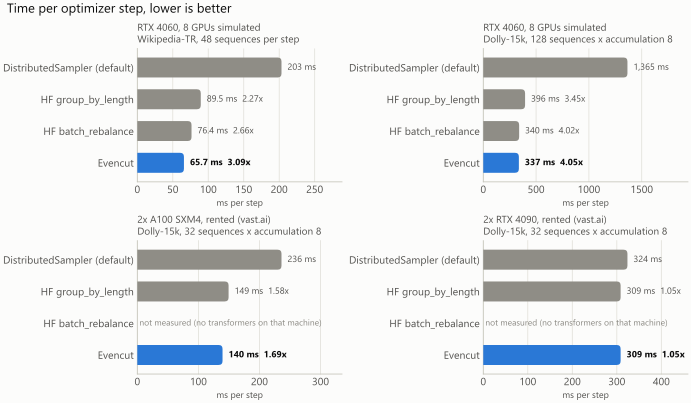

# Evencut

**Find the GPU time your data-parallel training loses to padding and waiting, win it back with a
drop-in batch sampler, and pick the machine that finishes the job for the least money.**

In data-parallel training every GPU pads its batch to the longest sequence in it, and every
optimizer step waits for the slowest GPU. With text of mixed lengths that can be most of the GPU
time. Evencut measures how much, removes it without changing which sequences train together in a
step, and tells you which machine runs your job for the least money.

Full documentation, with every measurement and its source: **[README on GitHub](https://github.com/AlemdarCode/evencut#readme)**
(also in [Turkish](https://github.com/AlemdarCode/evencut/blob/main/README.tr.md)).

## Install

```bash
pip install "evencut[train]"   # evencut, the evencut-train command, and tokenizers for `evencut-train lengths`
pip install "evencut[hf]"      # adds the Hugging Face Trainer integration
```

Install PyTorch yourself, in the build that matches your GPU. The sampler and `probe` need it;
`diagnose` and `pick` do not. Wheels with the native library are published for Linux (x86-64 and
ARM64), Windows (x86-64) and macOS (Apple Silicon and Intel). Elsewhere pip builds the library
from source, which needs a C++20 compiler; if that build fails, pip installs the pure-Python
version, which gives the same answers more slowly. `python -c "import evencut; print(evencut.backend)"`
shows which one you have.

## Use

```bash
# 1. Where does the GPU time go? No GPU needed; takes seconds.
evencut-train diagnose lengths.txt --gpus 8 --per-device-batch 8 --max-len 2048

# 2. Measure a machine for your model shape: about two minutes, run on that machine.
torchrun --standalone --nproc-per-node=gpu -m evencut.train probe \
    --layers 12 --d-model 768 --vocab 32000 --max-len 2048 --price-per-hour 1.90 -o box.json

# 3. Which machine finishes the job for the least money?
evencut-train pick lengths.txt --sequences-per-step 64 --per-device-batch 8 --probe box.json other.json
```

The fix is one line in the training script:

```python
loader = DataLoader(ds, batch_sampler=BalancedBatchSampler(lengths, per_device_batch=8), collate_fn=pad_to_longest)
```

Recipes for PyTorch DDP, the Hugging Face Trainer, Lightning and Accelerate are in the
[README](https://github.com/AlemdarCode/evencut#2-fix-balancedbatchsampler).

## Results



| setup | DistributedSampler | HF `group_by_length` | HF `batch_rebalance` | Evencut |
|---|--:|--:|--:|--:|
| 2x A100 SXM4 80GB, rented. Dolly-15k, 32 sequences × accumulation 8 | 236.1 ms | 149.4 ms (1.58x) | not run | **139.5 ms (1.69x)** |
| 2x RTX 4090, rented. Same job | 323.9 ms | 308.5 ms (1.05x) | not run | **308.5 ms (1.05x)** |
| RTX 4060 simulating 8 GPUs. Dolly-15k, 128 sequences × accumulation 8 | 1,365 ms | 395.9 ms (3.45x) | 339.7 ms (4.02x) | **337.2 ms (4.05x)** |
| RTX 4060 simulating 8 GPUs. Wikipedia-TR, 48 sequences per step | 203.2 ms | 89.5 ms (2.27x) | 76.4 ms (2.66x) | **65.7 ms (3.09x)** |

Time per optimizer step, lower is better. In every Evencut row each step trains on exactly the
sequences a shuffled `DistributedSampler` run puts in it; only which GPU gets which sequence
changes. Not every machine gains: on the 2x RTX 4090 box padding fell from 73% to 10% of the
tokens, yet the step got only 5% faster, and `diagnose` with a probe of the machine shows this
before you change anything. Where every number comes from is listed in
[How we tested](https://github.com/AlemdarCode/evencut#how-we-tested).

Under the training tools is an exact partitioning engine (C++ header, C ABI, CLI, Python, HTTP
service): give it an ordered list of costs and a number of parts, and it returns the proven
optimal cut points. See [The partitioning engine](https://github.com/AlemdarCode/evencut#the-partitioning-engine).

## License

Dual-licensed under [MIT](https://github.com/AlemdarCode/evencut/blob/main/LICENSE-MIT) or
[Apache 2.0](https://github.com/AlemdarCode/evencut/blob/main/LICENSE-APACHE), at your option.
Security problems: please report them privately as described in
[SECURITY.md](https://github.com/AlemdarCode/evencut/blob/main/SECURITY.md).
